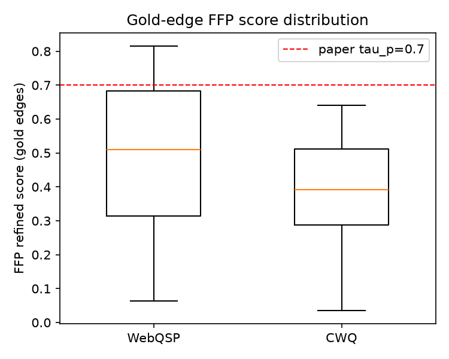
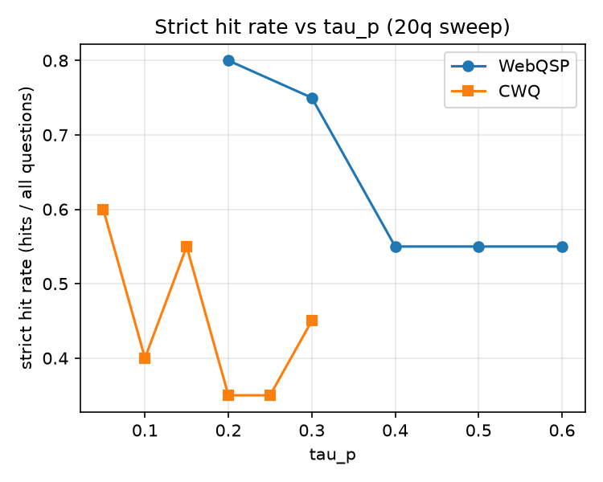

# FoG 复现初步分析（FSE → FFP → E2E）

> 数据归档位置：`analysis/archive/logs/`（42 份日志，含 FSE/FFP/E2E 扫描、逐题 trace、黄金边分数分布、llm_usage.csv）。
> 说明：本报告是在“全量 mini 测试”跑完之前的中间结论，所有百分比均为小样本（10/20/200/300 题）或检索层口径。

## 1. FSE 阶段（子图展开与剪枝）

数据层候选池黄金边召回：WebQSP 94.1%，CWQ 89.3%。

检索层深度调度扫描（200 题）：

| 配置 | WebQSP R_evid | WebQSP H_path | CWQ R_evid | CWQ H_path |
| --- | --- | --- | --- | --- |
| fixed τ_e=0.1 | 0.606 | 0.568 | 0.848 | 0.793 |
| depth 0.03/0.15 | 0.764 | 0.739 | 0.918 | 0.864 |
| depth 0.02/0.10 | 0.804 | 0.784 | 0.942 | 0.914 |
| depth 0.01/0.08 | — | — | 0.953 | 0.934 |
| degree β=0.5 | 0.795 | 0.749 | — | — |

结论：

- 深度调度（近源宽松、远端收紧）明显优于固定阈值，WebQSP 的 R_evid 从 0.606 提到 0.804，CWQ 从 0.848 提到 0.942；这是当前最有效的 FSE 优化。
- 度数归一化（β=0.5/1.0）在 WebQSP 上噪声剪枝崩坏（P_prune 0.579/0.723），记为遗留问题，不作为默认。
- 仍有少量黄金边在候选覆盖（约 1/10）和 FSE 剪枝（约 1/10）中丢失，是后续可继续优化的点。

## 2. FFP 阶段（远到近反馈重打分）

### 2.1 训练数据与方式

- Scorer（问题引导三元组打分器）：输入为候选三元组，正样本 = 黄金推理路径上的三元组，负样本 = 局部负采样（κ=10），按二分类训练。
- FFP（远到近消息传递 + 重打分）：在 scorer 打分之上，用黄金路径监督训练重打分。WebQSP 为 scorer+FFP 联合训练；CWQ 因显存限制冻结 scorer、只训 FFP 的轻量 MLP。
- 具体训练参数见 7.2 节（epochs=5、lr=1e-5、AdamW、weight_decay=1e-3、amp、batch_questions=8、max_triples_per_forward）。

### 2.2 基线对比（no-FFP vs with-FFP，验证集边级）

| 数据集 | 配置 | AUC | τ_e recall | τ_e kept_frac | τ_p recall |
| --- | --- | --- | --- | --- | --- |
| WebQSP | no-FFP | 0.9335 | 0.8906 | 0.2113 | 0.2033 |
| WebQSP | with-FFP | 0.9601 | 0.8122 | 0.1089 | 0.4390 |
| CWQ | no-FFP | 0.9613 | 0.9115 | 0.1562 | 0.0 |
| CWQ | with-FFP | 0.9682 | 0.9095 | 0.1477 | 0.1231 |

解读：FFP 后 AUC 与 `τ_p` recall 明显提升；`τ_e` recall / kept_frac 略降，是因为 FFP 重排序后按 `τ_e` 剪枝更聚焦。CWQ 的 `τ_p` recall 从 0 提到 0.123，但绝对值仍很低，反映“冻结 scorer、只训 FFP”的局限。

黄金边 FFP 重打分分布：

- CWQ（30 题，53 条黄金边）：min 0.035 / p50 0.392 / p90 0.569 / max 0.641；>0.7 的比例为 0%。
- WebQSP（30 题，30 条黄金边）：min 0.064 / p50 0.509 / p90 0.798 / max 0.816；>0.7 的比例为 20%。
- 分位数标签含义见 10.1 节。

结论：

- FFP 机制有效：边级 AUC 和 τ_p recall 都提升，方向与论文消融一致。
- 但绝对分数系统性偏低——我们的 scorer/FFP 重打分达不到论文口径的 `τ_p=0.7`。CWQ（冻结 scorer、只训 FFP）尤其严重，黄金边中位数只有 0.39。这是当前最大的系统性问题。

## 3. E2E 阶段（端到端 Hit/Hit@1/F1）

默认 `τ_p=0.7` 下：WebQSP 10 题 Hit=0.40，CWQ 10 题 Hit=0.00。

`τ_p` 扫描（20 题）：

| tau_p | WebQSP Hit | CWQ Hit |
| --- | --- | --- |
| 0.05 | — | 0.857（14/20 完成，6 错） |
| 0.10 | — | 0.471 |
| 0.15 | — | 0.647 |
| 0.20 | 0.842 | 0.438 |
| 0.25 | — | 0.368 |
| 0.30 | 0.750 | 0.474 |
| 0.40 | 0.550 | — |
| 0.60 | 0.550 | — |

WebQSP 10 题逐题失败归因（`tau_p=0.7`）：`CD_tau_p` 6/10、`C_pruned` 1/10、`A_candidate` 1/10、`D_answer` 0/10。

模型选择：

- WebQSP：`gpt-4o-mini` + `tau_p=0.30` → 70% Hit、0 报错；`gpt-4o` 同参数 75%。mini 性价比高。
- CWQ：`gpt-4o-mini` 有 4/10 题 `selected_membership`（模型改写/合并三元组，语义级偏差），归一化匹配只能救回 2 题，暂不建议 mini。

结论：

- 端到端链路已全通，错误可分类、逐题可追。
- 瓶颈是 `τ_p` 与我们的 FFP 分数分布不匹配，不是 LLM 本身（WebQSP 的 `D_answer=0`）。
- 调低 `τ_p` 后效果大幅回升：WebQSP 建议 0.20~0.30，CWQ 建议 0.05~0.15。

## 4. 最终成绩出来前可得到的结论

1. 复现流水线 A→B→C→D→E 已全部打通，能稳定跑完全量、错误全落盘。
2. FSE 深度调度和 FFP 在检索层/边级都验证有效，与论文消融方向一致。
3. 当前首要瓶颈是 scorer/FFP 的分数校准：不能沿用论文 `τ_p=0.7`，需按我们自己的分数分布定标。
4. LLM 不是当前瓶颈；WebQSP 可用 `gpt-4o-mini` 降成本，CWQ 建议保留 `gpt-4o`。
5. 后续优先级：CWQ 联合训练 scorer/FFP（提升重打分置信度）> FSE 对低分黄金边的保留 > mini 在 CWQ 的字面一致性问题。

## 5. 复现的局限与优势（自评）

坏的一面：

1. Scorer 是重构实现，架构细节与论文存在差异。论文只给出高层组件（冻结 Qwen3-Embedding-4B 编码器 + 三元组 self-attention + 问题 cross-attention + 子问题注意力池化 + MLP 打分），精确超参（维度、层数、head、初始化）未公开；复现版 scorer 整体打分偏低——CWQ 黄金边中位数 0.39、0% 超过 0.7，WebQSP 黄金边 0.16~0.70，与论文口径 `τ_p=0.7` 不匹配。
2. 受资源限制，CWQ 没有做 scorer+FFP 全量联合训练，改为“冻结 scorer、只训 FFP”的轻量方案，效果进一步衰退：CWQ 的 `τ_p` recall 仅 0.123，而 WebQSP 联合训练为 0.439。
3. 模型选择受预算限制，全量测试只能跑 `gpt-4o-mini`；该模型在 CWQ 上出现约 4/10 的三元组字面一致性问题（`selected_membership`），进一步损失质量。

好的方面：

4. 在 FSE（Foresight Subgraph Expansion，前瞻子图展开）阶段做了 `τ_e` 深度调度优化：不再对每一跳使用统一的展开阈值，而是近源层放宽（`tau_lo=0.02`）、远端层收紧（`tau_hi=0.10`），在尽量保留黄金证据的同时抑制远端噪声。效果：WebQSP 的 `R_evid` 从固定阈值的 0.606 提升到 0.804、`H_path` 0.568→0.784；CWQ 的 `R_evid` 0.848→0.942、`H_path` 0.793→0.914，追回了不少检索层表现。

## 6. 全量测试结果（gpt-4o-mini，最终参数）

| 数据集 | 参数 | 完成 n / 总题 | errors | Hit | Hit@1 | F1 |
| --- | --- | --- | --- | --- | --- | --- |
| WebQSP | tau_p=0.30 | 1424 / 1523 | 99 (6.5%) | 0.4726 | 0.4473 | 0.4593 |
| CWQ | tau_p=0.15 | 2287 / 2931 | 644 (22.0%) | 0.3209 | 0.2790 | 0.3073 |

错误分布：

- WebQSP：`selected_membership` 60、`answer_membership` 28、`unclassified`（排序 JSON/ValueError）11。
- CWQ：`selected_membership` 580、`answer_membership` 59、`unclassified` 3、`questions_required` 1、`question_limit` 1。

对比论文 FoG+GPT-4o-mini（WebQSP 88.68/87.23/75.16，CWQ 82.33/73.45/66.56）：WebQSP Hit 低约 41 个点、CWQ Hit 低约 49 个点。按“命中题数 / 总题数”的严格口径，WebQSP 约 44.2%（673/1523）、CWQ 约 25.0%（734/2931）。

## 7. 全量结论、瓶颈定位与局限

全量结果（`gpt-4o-mini`）与论文 FoG+mini 的差距：WebQSP Hit −41 点、CWQ Hit −49 点。按命中题数/总题数口径，WebQSP 仅 44.2%、CWQ 仅 25.0%。

### 7.1 瓶颈点（按影响排序）

1. **scorer/FFP 分数校准偏低（最大瓶颈）**。黄金边 FFP 重打分中位数 CWQ 0.39、WebQSP 0.16~0.70，0% 超过论文口径 `τ_p=0.7`；即使调低 `τ_p`，仍有 `CD_tau_p` 漏边，且正负样本区分度不足。这是与论文差距的主要来源。
2. **gpt-4o-mini 的字面一致性差（经费强制的代价）**。CWQ 644 个错误中 580 个是 `selected_membership`，WebQSP 99 个错误中 88 个是 membership 类（selected/answer）。mini 无法逐字复刻三元组/答案，直接让 CWQ 22% 的题目被判失败。
3. **CWQ 未做 scorer+FFP 联合训练（资源限制）**。CWQ 采用冻结 scorer、只训 FFP 的轻量方案，`τ_p` recall 仅 0.123（WebQSP 联合训练为 0.439），重打分置信度天然更低。
4. **FSE 阶段仍有黄金边丢失**。候选覆盖约 1/10、FSE 剪枝约 1/10 的黄金边在更早阶段就丢失，构成命中上限的一部分损失。
5. **LLM 语义回答错误占比小**（不是当前主瓶颈）。WebQSP 逐题归因中 `D_answer=0/10`；CWQ 上除 membership 外，`answer_membership=59` 也有一部分语义/字面混杂。

### 7.2 明确局限

- **scorer 细节未知**：论文只公开高层组件（冻结编码器 + 三元组 self-attention + 问题 cross-attention + 子问题注意力池化 + MLP），精确超参未公开，复现版 scorer 属重构实现，打分系统性偏低。
- **训练资源受限**：CWQ 无法做全量联合训练（显存不足），只能冻结 scorer、轻量训练 FFP，效果进一步衰退。
- **经费受限（模型选择）**：`gpt-4o` 与 `gpt-4o-mini` 的 API 单价约差 16 倍（input $2.5/1M vs $0.15/1M，output $10/1M vs $0.6/1M），全量 4454 题估算 `gpt-4o` 约 $190、`gpt-4o-mini` 约 $15，整体预算差约一个量级。因此全量只能跑 `gpt-4o-mini`；`gpt-4o` 仅做了小范围验证（WebQSP/CWQ 各 10~20 题的 `tau_p` 扫描与冒烟，用于定出最优 `tau_p` 后再切到 mini），没有 gpt-4o 的全量成绩。mini 在 CWQ 上还引入大量 `selected_membership`/`answer_membership` 字面一致性问题。
- **数据/子图覆盖非满分**：部分题目的黄金边在候选子图构建阶段就无法覆盖（WebQSP 候选召回 94.1%、CWQ 89.3%），这是可达到命中率的上限之一。

#### 具体训练参数、含义与取舍

| 参数 | 取值 | 含义 | 为什么这样取舍 |
| --- | --- | --- | --- |
| `epochs` | 5 | 训练轮数 | 验证 AUC 在 5 轮内基本收敛，更多轮数边际收益小且费算力 |
| `optimizer` / `lr` | AdamW / `1e-5` | 优化器与学习率 | 冻结大编码器、只微调小 scorer/FFP，用小 lr 防止破坏预训练表征 |
| `weight_decay` | `1e-3` | L2 权重衰减 | 正则化小 MLP，抑制过拟合 |
| `negative_sample_ratio`（κ） | 10 | 负采样比 | 对齐论文口径，平衡正负样本 |
| `batch_questions` | 8 | 问题级 batch 大小 | 在显存占用与梯度稳定性之间折中 |
| `max_triples_per_forward` | WebQSP 64 / CWQ 512 | 三元组微批大小 | 微批前向避免 OOM；CWQ 冻结 scorer 后单次可放更大批 |
| `amp` | true | 自动混合精度 | 降低显存、加快训练 |
| `freeze_scorer` | WebQSP false / CWQ true | 是否冻结 scorer | CWQ 全量联合训练实测会 OOM（约需 103GB），故冻结 scorer、只训 FFP；代价是重打分置信度下降 |
| `max_nodes` / `max_edges` | WebQSP 12000/16000；CWQ 8000/10000 | 子图预算上限 | 受 RTX PRO 6000 显存限制：WebQSP 联合训练需压到 12000/16000，CWQ 进一步压到 8000/10000 |
| `limit_train` | 8000（CWQ 轻量） | 训练样本上限 | 进一步控制训练时长与成本 |
| `node_degree_max` | 20000 | 枢纽节点展开阈值 | 数据层网格定标后取黄金边召回最优的取值 |

核心取舍：WebQSP 走“scorer+FFP 联合训练”，子图预算取 12000/16000；CWQ 因 RTX PRO 6000 显存限制被迫“冻结 scorer、只训 FFP、限制训练样本”，子图预算进一步降到 8000/10000，换来可跑通但打分更低，这也是 CWQ 与论文差距比 WebQSP 更大的直接原因之一。

### 7.3 未来改进建议（按优先级）

1. **重训/重校准 scorer 与 FFP**：争取大显存对 CWQ 做 scorer+FFP 联合训练；对 scorer 做温度缩放/标签平滑；按我们自己的分数分布重新扫描定标 `τ_p`（而不是沿用 0.7）。
2. **降低 mini 的字面一致性损失**：在 NFC+strip 基础上，进一步做实体 ID/别名归一化匹配，或分数据集选模型（WebQSP 用 mini、CWQ 用 gpt-4o）。
3. **提升 FSE 黄金边保留**：优化 `rel_blocklist`/`node_degree_max` 网格，研究低分黄金边的保底注入策略。
4. **补 LLM-only mini 基线**（Zero-shot/CoT），量化图模块在预算约束下的真实增益。
5. **小样本同配置 gpt-4o 对照**：若预算允许，抽 20~30 题用 gpt-4o 跑同参数，量化“mini 掉点”与“scorer 掉点”各自贡献。

## 8. 最优 tau_p 的确定依据（数据）

`tau_p` 是在 `gpt-4o` 上用 20 题小样本扫描定出的，之后 `gpt-4o-mini` 沿用同一取值。

WebQSP（`--limit 20`）：

| tau_p | 完成 n | errors | Hit |
| --- | --- | --- | --- |
| 0.20 | 19 | 1 | 0.842 |
| 0.30 | 20 | 0 | 0.750 |
| 0.40 | 20 | 0 | 0.550 |
| 0.50 | 20 | 0 | 0.550 |
| 0.60 | 20 | 0 | 0.550 |

WebQSP 选 `0.30` 的理由：`0.20` 命中更高（84.2%）但出现 1 个报错；`0.30` 是“0 报错且命中仍保持 75%”的最稳点。考虑到全量要稳健、且 mini 会额外引入字面一致性错误，取更保守的 `0.30`。

CWQ（`--limit 20`）：

| tau_p | 完成 n | errors | Hit |
| --- | --- | --- | --- |
| 0.05 | 14 | 6 | 0.857 |
| 0.10 | 17 | 3 | 0.471 |
| 0.15 | 17 | 3 | 0.647 |
| 0.20 | 16 | 4 | 0.438 |
| 0.25 | 19 | 1 | 0.368 |
| 0.30 | 19 | 1 | 0.474 |

CWQ 选 `0.15` 的理由：`0.05` 命中最高（85.7%）但 20 题里 6 题报错、完成率低；`0.15` 是“命中 64.7%、仅 3 错、完成 17/20”的最优折中点；`0.20` 及以后命中掉到 43.8% 以下，收益不再划算。

黄金边保留率佐证（CWQ 30 题、53 条黄金边）：

| tau_p | 0.10 | 0.20 | 0.30 | 0.40 | 0.50 | 0.70 |
| --- | --- | --- | --- | --- | --- | --- |
| 黄金边保留率 | 83.0% | 75.5% | 73.6% | 47.2% | 26.4% | 0.0% |

`0.15` 落在黄金边保留率约 80% 的区间（0.10 与 0.20 之间），既保住多数黄金证据，又能剪掉一部分噪声；而论文默认 `0.70` 在复现版上黄金边保留率为 0，因此必须按我们自己的分数分布重新定标。

## 9. 其他可量化的分析

### 9.1 LLM 调用与成本（llm_usage.csv 实测，含全部冒烟/扫描/全量）

| 指标 | 数值 |
| --- | --- |
| 总调用次数（含重试） | 11,160 |
| 传输层错误行 | 17 |
| 输入 tokens 总量 | 114,001,791（mean 10,230 / p50 8,240） |
| 输出 tokens 总量 | 1,097,550（mean 98 / p50 58） |
| 估算费用（gpt-4o-mini 价） | ≈ $17.8 |

### 9.2 gpt-4o 与 gpt-4o-mini 同配置小样本对照

| 数据集 | tau_p | gpt-4o | gpt-4o-mini |
| --- | --- | --- | --- |
| WebQSP | 0.30 | Hit 75%（20 题，0 错） | Hit 70%（10 题，0 错） |
| CWQ | 0.15 | Hit 64.7%（20 题，17 完成，3 错） | Hit 33.3%（10 题，6 完成，4 错） |

结论：WebQSP 上 mini 仅比 gpt-4o 低约 5 个点，性价比高；CWQ 上 mini 的完成率与命中率都明显崩坏，主要是 `selected_membership` 字面一致性问题。

### 9.3 小样本 vs 全量偏差（gpt-4o-mini）

| 数据集 | 小样本 Hit | 全量 Hit | 说明 |
| --- | --- | --- | --- |
| WebQSP | 70%（10 题） | 47.3% | 前 10 题样本偏简单 |
| CWQ | 50%（10 题，4 完成） | 32.1% | 全量完成率与命中率都更低 |

结论：小样本冒烟明显偏乐观，不能作为最终成绩，只能用于参数定标和链路验证。

### 9.4 运行时长

| 数据集 | 题目数 | 运行时长 |
| --- | --- | --- |
| WebQSP | 1523 | 11,977s（约 3.3h） |
| CWQ | 2931 | 22,385s（约 6.2h） |

## 10. 补充分析（数据与图）

### 10.1 黄金边分数分布（WebQSP vs CWQ）

分位数表（FFP 重打分）：

| 数据集 | n | min | p25 | p50 | p75 | p90 | max |
| --- | --- | --- | --- | --- | --- | --- | --- |
| WebQSP | 30 | 0.064 | 0.315 | 0.509 | 0.683 | 0.798 | 0.816 |
| CWQ | 53 | 0.035 | 0.287 | 0.392 | 0.511 | 0.569 | 0.641 |

分位数标签含义：`min`/`max` 为最小/最大值；`p25`（=Q1，下四分位数）表示 25% 的黄金边分数低于该值；`p50` 为中位数，一半数据低于该值；`p75`（=Q3，上四分位数）表示 75% 的数据低于该值；`p90` 表示 90% 的数据低于该值。例如 CWQ 的 `p50=0.392`，即有一半黄金边被 FFP 打到 0.392 以下。

各 `tau_p` 黄金边保留率：

| tau_p | WebQSP | CWQ |
| --- | --- | --- |
| 0.10 | 90.0% | 83.0% |
| 0.20 | 83.3% | 75.5% |
| 0.30 | 76.7% | 73.6% |
| 0.40 | 60.0% | 47.2% |
| 0.50 | 50.0% | 26.4% |
| 0.60 | 40.0% | 9.4% |
| 0.70 | 20.0% | 0.0% |

WebQSP（联合训练）的黄金边分数整体高于 CWQ（冻结 scorer + 只训 FFP），且仍有 20% 超过 0.7；CWQ 则 0% 超过 0.7。

### 10.2 严格命中率曲线（命中题数 / 总题数）

| tau_p | WebQSP 严格 Hit | CWQ 严格 Hit |
| --- | --- | --- |
| 0.05 | — | 0.60 |
| 0.10 | — | 0.40 |
| 0.15 | — | 0.55 |
| 0.20 | 0.80 | 0.35 |
| 0.25 | — | 0.35 |
| 0.30 | 0.75 | 0.45 |
| 0.40 | 0.55 | — |
| 0.50 | 0.55 | — |
| 0.60 | 0.55 | — |

把报错题也计入分母后，WebQSP 峰值仍是 0.20（80%）、CWQ 峰值仍是 0.05（60%），且 CWQ 的 0.15（55%）与 0.05 差距明显缩小——说明“完成题命中率”会把低完成率的 0.05 高估。

### 10.3 检索层三指标：固定阈值 vs 深度调度

| 配置 | 数据集 | R_evid | P_prune | H_path |
| --- | --- | --- | --- | --- |
| fixed τ_e=0.1 | WebQSP | 0.606 | 0.964 | 0.568 |
| depth 0.02/0.10 | WebQSP | 0.804 | 0.949 | 0.784 |
| degree β=0.5 | WebQSP | 0.795 | 0.579 | 0.749 |
| fixed τ_e=0.1 | CWQ | 0.848 | 0.887 | 0.793 |
| depth 0.02/0.10 | CWQ | 0.942 | 0.847 | 0.914 |
| depth 0.01/0.08 | CWQ | 0.953 | 0.822 | 0.934 |

深度调度在两个数据集上都显著提升 R_evid/H_path，噪声剪枝 P_prune 只小幅下降；度数归一化在 WebQSP 上 P_prune 崩坏（0.579），不适合作为默认。

### 10.4 失败漏斗（20 题逐题分类）

| 环节 | WebQSP（tau_p=0.30） | CWQ（tau_p=0.15） |
| --- | --- | --- |
| Hit | 12 | 8 |
| 候选覆盖漏（A） | 1 | 5 |
| FSE 剪枝漏（C） | 4 | 2 |
| tau_p 过滤漏（C→D） | 3 | 1 |
| LLM 回答漏（D） | 0 | 2 |
| 报错 | 0 | 2 |

WebQSP 的失败主要发生在 FSE 剪枝和 `tau_p` 过滤；CWQ 的失败主要发生在候选覆盖（5/20）和 LLM 阶段（2 漏 + 2 错）。两者在 LLM 之前的证据流失路径不同，后续优化点也应分开对待。
