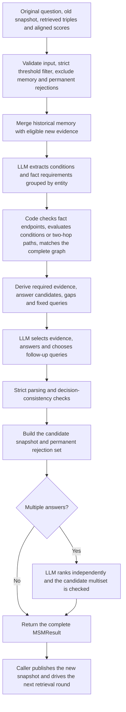

# Member D modules

[English](part_d.md) | [简体中文](part_d.zh-CN.md)

This document describes the implemented Member D modules. The default pipeline extracts the original question's information requirements, evaluates them in code, selects evidence and answers, validates before publication, and ranks multiple answers independently. The public entry point is `manage_memory`, which defaults to `prompt_variant="evidence_decision"`. Setup and environment preparation are in the [README](../README.md#llm-configuration). Member D acceptance uses controlled retrieval and scoring inputs with real LLM calls; Member E owns C/E pipeline integration, actual retrieval and overall run behavior, and that integration is not a prerequisite for accepting these modules.

## Primary deliverables

### `decompose_question`

Break the original question into a set of independently retrievable sub-questions. The default prompt makes each sub-question repeat known entity names or relational descriptions of unresolved entities without assuming earlier answers; the returned order follows the model output.

Inputs:

| Variable | Type | Meaning |
| --- | --- | --- |
| `question` | `str` | Nonblank original question, inserted verbatim without rewriting. |
| `client` | `LLMClient` | Caller-owned LLM client that the caller closes. |
| `prompt_variant` | `str` | Keyword-only; defaults to `"explicit_references"`; see the value list below. |

`prompt_variant` values:

- `"explicit_references"` (default): inserts an independent-retrieval section into the Figure 7 template, requiring each sub-question to be retrievable on its own by repeating known entity names or relational descriptions of unresolved entities without assuming an earlier answer.
- `"paper"`: keeps only the original Figure 7 instructions (numbering from $1$) without that section, for paper reproduction and comparison.

Outputs:

| Variable | Type | Meaning |
| --- | --- | --- |
| `sub_questions` | `list[str]` | Ordered sub-question list with literal strings for separate retrieval. |

### `manage_memory`

Complete one memory-update round for an independent question run: filter the potential subgraph, update memory and answer through the LLM, then rank multiple answers separately. It returns a publishable frozen result only after the whole call succeeds.

Inputs:

| Variable | Type | Meaning |
| --- | --- | --- |
| `state` | `QuestionMemory` | Immutable snapshot of the current question run, created per independent question. |
| `triples` | `Sequence[Sequence[str]]` | Expanded triples from member C, each row containing three nonblank strings. |
| `scores` | `Sequence[Real]` | Finite refined scores positionally aligned with `triples`. |
| `client` | `LLMClient` | Caller-owned LLM client that the caller closes. |
| `potential_threshold` | `Real` | Strict cutoff for the potential subgraph, default `0.7`; a YAML-loaded value must be passed explicitly. |
| `prompt_variant` | `str` | Keyword-only; defaults to `"evidence_decision"`; see the value list below. |

A question snapshot (`QuestionMemory`) contains the verbatim original question `original_question`, the current memory graph `memory_triplets` and the permanent rejection graph `rejected_triplets`; `excluded_triplets` is their union, derived on demand. Full field constraints are in [Question-local persistent memory](#question-local-persistent-memory).

`prompt_variant` values:

- `"evidence_decision"` (default): first extracts the original question's information requirements (entities, relations and conditions to look up) under a strict JSON Schema, then code validates the question type, conditions and fact endpoints and derives required evidence, answer candidates and fixed queries. Final selection must pass decision-consistency checks: the evidence, answers and follow-up questions the model finally chooses must conform to the states, sets and constraints already computed by code, or no snapshot is published; see [Gap queries and publication gates](#gap-queries-and-publication-gates).
- `"paper"`: uses only the original Figure 8 prompt for a single selection, with no requirement-extraction or retrieval-wording addition; multiple answers are still ranked separately after selection.
- `"retrieval_questions"`: adds retrieval-question instructions to the Figure 8 prompt, requiring follow-up questions to target a knowledge-graph retriever, anchor named entities and ask only for missing relations; it remains a single selection.
- `"answer_ranking"`: adds both retrieval-question and answer-ranking instructions, asking the single selection stage to order candidates by evidential support; the separate ranking stage still runs for multiple answers.

Outputs:

| Variable | Type | Meaning |
| --- | --- | --- |
| `result` | `MSMResult` | Frozen result, published only after the whole call succeeds. |
| `result.state` | `QuestionMemory` | New snapshot produced by this round. |
| `result.response` | `MemoryResponse` | Validated structured output with selected triples, ranked answers and next-round sub-questions. |

`MSMResult` is a frozen, immutable container with only `state` and `response`: the former is the `QuestionMemory` snapshot used by the next round, and the latter keeps this round's selected triples, ranked answers and follow-up questions. An instance returned by `manage_memory` represents a publishable result only after the whole call succeeds; directly constructing the object performs no validation. Field details are in [Structured memory output](#structured-memory-output) and [Question-local persistent memory](#question-local-persistent-memory); usage is in [Scored-round MSM interface](#scored-round-msm-interface).

## Current default architecture



Intermediate decisions never publish memory. The final output must satisfy structure, input membership, required evidence, answer candidates, condition status and gap-query constraints at once; the public entry point returns a publishable result only after ranking also succeeds. Any stage failure propagates, and the caller keeps the old snapshot; there is no reselection, answer repair, question rewriting or business retry.

When the condition is unknown, the module protects the matched evidence of both branches and forbids an answer; once resolved, it protects only the applicable branch and the actual condition facts. Missing required evidence or an answer outside the code-computed candidates fails before a candidate snapshot is built. Local checks prove the output is consistent with the extracted requirements and the submitted graph; they do not prove question understanding or extraction semantics.

## LLM configuration and requests

[`llm_config.py`](../src/agent/llm_config.py) merges private `.env` overrides with shared YAML defaults and validates the effective configuration before a request. `LLM_MODEL_NAME` and `LLM_BASE_URL` may override the model and endpoint, while the key is read only from `LLM_API_KEY` in `.env`; timeout and maximum additional retries come only from the shared YAML. Shared defaults are `gpt-4o-mini` at `https://api.openai.com/v1`. Loading never reads process environment variables, and the key does not appear in the configuration object's representation.

[`llm_client.py`](../src/agent/llm_client.py) exposes `LLMClient.complete(messages, *, response_format=None)` for the OpenAI-compatible Chat Completions protocol, with environment-derived proxies disabled. Timeouts, connection failures, HTTP $429$ and HTTP $5xx$ allow at most `max_retries` additional attempts with delays of $1$, $2$, $4$, then at most $8$ seconds; other HTTP errors, non-object JSON responses and business validation failures are not retried. Model, endpoint and protocol never fall back automatically. The caller closes the client.

## Per-attempt usage accounting

[`llm_usage.py`](../src/agent/llm_usage.py) appends one UTF-8 CSV row per actual HTTP attempt, including failures and retries. The authoritative ledger is [`logs/llm_usage.csv`](../logs/llm_usage.csv), with columns `timestamp, model, input_tokens, output_tokens, status, error_type, request_id`.

The timestamp records the attempt start in UTC with an offset. Model and token counts prefer service-returned values; unknown token counts and request IDs stay blank, while reported zeros are preserved. An HTTP success remains `success` even if business validation later fails, and the exception class name alone is recorded. The log contains no keys, prompts, triples, reply text or exception messages; unknown usage is not zero consumption. The client checks the header and writability before sending, and an append failure propagates. Concurrent processes must serialize CSV writes at the caller.

## Initial question decomposition

[`question_decomposition.py`](../src/agent/question_decomposition.py) implements the initial sub-questions from FoG §3.1 and Figure 7. `decompose_question(question, client, *, prompt_variant="explicit_references")` requires each sub-question to be independently retrievable by default: repeat known entity names or relational descriptions of unresolved entities, do not assume earlier answers, and do not invent names. Prompt variants are listed under [`decompose_question`](#decompose_question). The ordered question list is returned for the caller to retrieve separately.

`build_decomposition_prompt` and `parse_sub_questions` work offline without API calls. The question must be a nonblank string and is inserted verbatim. A completed, nonrefused reply must be only a nonempty JSON array of nonblank strings; code fences, prose, malformed JSON and nonstring items fail, while strings, order and duplicates are preserved. Figure 7 sets no sub-question count limit. Invalid input or output raises `ValueError` without disclosing text and adds no extra request or substitute question.

## Potential subgraph construction

[`potential_subgraph.py`](../src/agent/potential_subgraph.py) implements FoG §3.3, Eq. 10: $G^{\mathrm{pot}} = \{t \in G^{\mathrm{xpd}} \mid s_t > \tau_p\}$. `build_potential_subgraph(triples, scores, potential_threshold=0.7)` accepts member C's refined scores after feedback propagation, aligned with the expanded triples.

```python
from src.agent.potential_subgraph import build_potential_subgraph

triples = [
    ("Country A", "anthem", "Song C"),
    ("Country A", "led_by", "Person B"),
]
potential = build_potential_subgraph(triples, [0.95, 0.7])
assert potential == [triples[0]]
```

The threshold is a finite real number, defaults to $0.7$ and is strict; equality is excluded. Scores must be a one-dimensional, positionally aligned sequence of finite real scalars, booleans are invalid, and tensors must be converted explicitly to one-dimensional Python lists. Each graph row must contain three nonblank strings. All rows are validated before filtering, including invalid low-scoring rows; strings, direction and first qualifying order are preserved. An exact duplicate row is admitted if any aligned occurrence exceeds the cutoff.

Filtering makes no LLM call and creates no rejection state, and it compares scores directly without sigmoid, normalization or clipping; member C owns the score scale. Evidence that is neither submitted this round nor in historical memory is never permanently rejected and can return once retrieval and scoring qualify it.

## Question-local persistent memory

[`memory_state.py`](../src/agent/memory_state.py) provides `QuestionMemory(original_question, memory_triplets=(), rejected_triplets=())`. Create a new instance for every independent question run, even with identical question text, and keep the snapshot across that run's rounds. Persistence means retention within the run, with no disk storage or global question cache.

The original question must be a nonblank string and is stored verbatim. Memory and permanent rejections are copied into `frozenset[tuple[str, str, str]]`; exact duplicates collapse, literal strings and edge direction remain unchanged, and the two sets must be disjoint. The snapshot and nested values are immutable, so later changes to supplied lists cannot affect it. The update flow builds new snapshots, and a failed call never changes the old one.

`state.excluded_triplets` returns the union of current memory and permanent rejections. `state.filter_expansion_triplets(candidates)` validates every candidate, then removes those exact triples in first occurrence order and deduplicates exact repeats. Sharing an entity or reversing an edge does not exclude another triple by itself. Absorbed memory is not expanded again, but it is still submitted from `state.memory_triplets` to every memory-management round; historical memory is not limited by current retrieval scores.

## Conditional evidence decision and memory publication

[`evidence_decision.py`](../src/agent/evidence_decision.py) implements information-requirement extraction and deterministic evaluation for the default pipeline. The first stage always receives the original question and the full union of historical memory and eligible new evidence; the model never prunes the graph first.

### Information-requirement extraction and endpoint binding

The first stage extracts the original question's information requirements under a strict JSON Schema; `description.kind` is `conditional_equals`, `nonconditional`, `nonconditional_path` or `unsupported`. The original question decides the type: only an explicit equality condition with true and false requirements uses `conditional_equals`; several named objects queried separately for attributes, or one object queried for several independent relations, use `nonconditional`; locating an entity and then asking for its attribute is a dependency and uses `nonconditional_path` even when the graph already names the intermediate entity. An equality condition describes the subject, relation, operator `eq`, comparison value, the condition quote from the original question and an optional single-value quote. The comparison value is only a constraint, never an observed fact; the model cannot invent a condition from the graph or infer single-valuedness from a definite article.

Each one-hop branch is organized as `requirements: [{entity, fact_queries: [{relation, binding}]}]`. `entity` is the known object whose attribute the question asks about, not the retrieved answer endpoint; each query inherits its group's entity instead of repeating an object field. Duplicate entity groups within one branch are rejected, so related multiple relations belong in one group. A conditional question supplies nonempty `true` and `false` branches; a nonconditional one-hop question supplies a single `branch`.

An `observed` binding references stable triple IDs in the current sorted graph, and each referenced triple's exact relation must have the group entity as one endpoint. Code checks IDs, relations and endpoint roles, derives outgoing or incoming from the endpoint position, and requires all references to support the same direction; a self-loop or ambiguous role fails the transaction. After direction is fixed, the complete graph is still scanned so every fact with that object, relation and direction is collected, not just the referenced one.

A `missing` binding declares a direction to retrieve and carries no predicted answer. Code checks exact facts in both directions: a hit in either direction fails with `decision_conflict`, and rejecting a match only in the other direction is a conservative policy that may reject a legitimate query; a gap is allowed only when neither direction has facts. The policy is not general relation-direction reasoning. IDs are valid only within the current request and never cross rounds.

### Nonconditional two-hop path evaluation

`nonconditional_path` uses a `root_entity` copied verbatim from the original question and exactly two ordered `steps`, each with a `relation` and `binding`, under a separate binding schema. A relation already present in the graph must match exactly; a missing relation is described by the model without naming intermediate entities or predicting answers.

An `observed` binding references only the current numbered graph's `evidence_ids`. Code derives the step direction from the endpoint roles of the current reachable frontier, scans every exact match in that direction and makes the far endpoint the next frontier. Out-of-range IDs, relation or connection mismatches, self-loops, ambiguous endpoint roles, and a declared direction with no fact while the reverse direction matches all fail the transaction. When only some frontier candidates have facts, the missing candidates keep the direction derived from the observed facts.

A completely missing step binds only `{"kind": "missing"}`, with no direction or evidence IDs; a `scope="incident"` relation-adjacency gap is created only when none of the current frontier entities has that exact relation in either direction. Declaring a gap while facts exist fails. Once the frontier is empty, only downstream requirements remain: no intermediate entity is invented and no query is generated for an unreachable object; when facts arrive later, observed bindings again derive the direction.

Code protects every reachable path prefix and forbids an answer while any candidate still has a gap; without gaps, answers must come from the terminal `answer_candidates`, never intermediate entities or disconnected endpoints. Path evaluation reuses the complete graph, required evidence, rejection and ranking publication rules, and persists neither cross-round evidence IDs nor a separate path state.

### Condition evaluation and required evidence

Code looks up actual condition values in the complete submitted graph by exact subject and relation, with the subject as head. A match with the comparison value is `true`; different values together with an explicit single-value statement in the original question are `false`; otherwise the status is `unknown`. Multiple actual values under a single-value premise fail, and a nonconditional question has status `not_conditional`. Missing facts are never treated automatically as a false condition.

The required set consists of the actual condition facts and all matched facts of the applicable branch. Unknown conditions merge both branches to protect existing candidate paths; a resolved condition uses only its branch. Answer candidates are the far endpoints of the applicable branch's matched facts (tail for outgoing, head for incoming), deduplicated by literal string and sorted lexicographically; candidates are empty while the condition is unknown, and condition facts contribute only when they also match an answering requirement. Code derives the answer targets and missing relations for the final selection stage instead of relying on the model to re-list required evidence.

### Gap queries and publication gates

`build_decision_memory_prompt` in [`memory_prompt.py`](../src/agent/memory_prompt.py) supplies the original question, the complete evidence, the derived decision and the required constraints to the final stage. When gaps exist, `missing_relation_queries` renders one query per gap, deduplicates exact strings and keeps first-occurrence order:

```text
Which entity does "<target>" connect to through relation "<relation>"?
Which entity connects to "<target>" through relation "<relation>"?
Find triples involving "<target>" with relation "<relation>".
```

The first two templates serve gaps with a known direction; the third exists only for a two-hop `scope="incident"` gap when the edge is entirely missing, allowing facts where the target is either head or tail. The module does not guess a direction first, flip old queries automatically or send both directions at once; the round's allowed query list is then appended to the final request. The contract does not guarantee correct naming of the missing relation; actual recall and cost are validated by Member E during integration.

The final request always uses the base strict `MEMORY_RESPONSE_FORMAT` schema and generates no dynamic query enumeration. The model selects queries verbatim through `subsequent_question`; local checks require a nonempty, duplicate-free subset of the allowed queries that includes every unknown-condition query. At most three questions are allowed, and remaining gaps can be retrieved in later rounds; an unasked gap does not become satisfied.

The final output first passes `parse_memory_response`; `validate_decision_response` then performs the decision-consistency checks: all required evidence is selected; no answer is given under an unknown condition; a resolved or nonconditional gap-free decision answers without further questions; and one-hop, conditional and two-hop answers belong to their respective `answer_candidates`. Any inconsistency fails before an inheritable snapshot is returned. Fixed queries guarantee consistency with the derived gaps, not complete extraction or real retrieval recall.

### Explicit comparison interfaces

`manage_memory` and `update_memory` both default to the two-stage decision pipeline above. All `prompt_variant` values are listed under [`manage_memory`](#manage_memory); a default failure never switches to another variant automatically. Every public `manage_memory` variant keeps separate multiple-answer ranking.

`build_memory_prompt` only builds a single-selection prompt and still defaults to `retrieval_questions`; it is not the complete transaction entry point. It retains the paper's high-recall, evidence-only answering and exact-copying requirements, and callers should use `manage_memory` for the default publication protection.

## Structured memory output

[`memory_response.py`](../src/agent/memory_response.py) provides `parse_memory_response(content, memory_triplets, potential_triplets)`. It is the base parsing boundary for final output and handles neither first-stage extraction nor complete transaction publication. The reply must be one complete standard JSON object with exactly these three array fields:

```json
{
  "selected_triplets": [],
  "predict_answer": [],
  "subsequent_question": []
}
```

The all-empty object is only a format example: without an answer, $1$ to $3$ nonblank questions are still required. Each `selected_triplets` row must contain three nonblank strings and match a complete triple actually submitted in this call's union verbatim; field positions, direction, case, whitespace and Unicode are not normalized. `predict_answer` must exactly equal a head or tail entity of the selected triples; answers found only in unselected evidence, only as a relation, or rewritten in any way are rejected. An empty selection can only return empty answers.

The result is an immutable `MemoryResponse` whose three fields are tuples, with triple rows as tuples too. Base parsing preserves literal strings, row order and duplicates; the default pipeline additionally applies the allowed-set and duplicate checks described above to follow-up questions. Missing, extra or duplicate fields, code fences, extra prose, trailing values, nonstandard JSON numbers and out-of-range values all fail without repair.

The parser can check entity membership along any selected path, but local membership does not prove answer semantics, completeness or support strength, and ranking never restores omitted answers. Constructing a `MemoryResponse` container directly performs none of these checks.

## LLM-guided memory replacement

[`memory_update.py`](../src/agent/memory_update.py) provides `update_memory(state, potential_triplets, client, *, prompt_variant="evidence_decision")`, which performs the pre-ranking decision, final selection, parsing and candidate-snapshot construction. New memory is exactly the set of selected triples; old evidence survives only when selected again and is not automatically unioned with old memory. The default required-evidence constraints protect evidence needed by the current requirements before allowing inapplicable old evidence to be removed.

Potential input accepts empty graphs and generators and is materialized once so every stage sees the same evidence. An invalid state, a malformed graph or potential input overlapping the permanent rejection set fails before the request. A candidate snapshot is built only for a normally completed, nonrefused transaction that passes all output and decision checks; submitted but unselected triples then join permanent rejection. Transport and accounting errors propagate. This lower-level interface performs no separate ranking, so complete MSM calls should use the public entry point.

## Exploration efficiency

Let the actually submitted union be $U = G^{\mathrm{mem}} \cup G^{\mathrm{pot}}$, the selected set $S$ and the prior permanent rejections $R$. After every check passes, new memory is $S$ and permanent rejections become $R' = R \cup (U \setminus S)$. Submitted but unselected new evidence and old memory both become permanent rejections, and the rule lasts for the whole question run, including after memory is emptied.

Reading every omitted submitted input as an explicit rejection is a user-approved reproduction assumption; the paper does not define this mapping explicitly. Published rejections are never lifted automatically, and the default pipeline protects necessary evidence through the pre-publication required-evidence and candidate checks. Format, decision, consistency, transport or ranking failures publish no new rejection.

Callers apply `state.filter_expansion_triplets` at retrieval and expansion boundaries before scoring. Public `manage_memory` also filters eligible potential input so permanently rejected evidence is never submitted to the LLM again. Absorbed memory is added back to the submitted union independently from the old snapshot. This module implements no retriever and does not modify member C's scoring.

## Fault tolerance for threshold-hidden evidence

Evidence with score $s_t \leq \tau_p$ that is not in historical memory is outside the round's submitted union and acquires no permanent rejection. The caller passes the actual `response.subsequent_question` to retrieval, and after re-expansion, filtering and scoring, previously hidden evidence re-enters the potential graph as soon as its score strictly exceeds the cutoff. Recovery depends on renewed retrieval and scoring; the threshold is not lowered automatically and facts are not reinserted.

An empty potential graph is valid: historical memory is still submitted, and when both are empty an empty graph is submitted so missing relations drive follow-up queries. Permanently rejected evidence stays filtered even when resubmitted at a high score. All state is isolated per independent question run and never shared because question text matches.

## Separate answer ranking

[`answer_ranking.py`](../src/agent/answer_ranking.py) makes a separate LLM call when the final answer has at least two candidates. Its input contains only the original question, the actual selected triples and the actual candidates, without retrieval scores, gold labels or unselected evidence. Zero or one answer skips it automatically, and there is no business switch to disable ranking.

The ranking reply must complete normally, be nonrefused and return only `predict_answer`. Candidate strings and their multiset must remain identical: adding, omitting, renaming or deduplicating is forbidden, and only the order may change, without altering evidence, questions, memory or permanent rejections. Ranking cannot repair omitted answers or missing paths. If ranking fails, complete `manage_memory` returns no candidate snapshot. `manage_memory_ranked` is a compatibility alias for `manage_memory` with identical behavior.

## Scored-round MSM interface

[`memory_management.py`](../src/agent/memory_management.py) exposes `manage_memory(state, triples, scores, client, potential_threshold=0.7, *, prompt_variant="evidence_decision")`. Member C supplies aligned triples and refined scores; member E owns the question snapshot, retrieval loop, client lifetime and stopping policy. The function reads no configuration, performs no retrieval and does not mutate state in place. It applies the state exclusion after threshold filtering so absorbed or rejected evidence is not submitted to the prompt again.

```python
from src.agent.llm_client import LLMClient
from src.agent.llm_config import load_llm_config
from src.agent.memory_management import manage_memory
from src.agent.memory_state import QuestionMemory

state = QuestionMemory("Which city was Mira Vale born in?")
client = LLMClient(load_llm_config())
try:
    result = manage_memory(
        state,
        [("Mira Vale", "born_in", "Linden City")],
        [0.95],
        client,
        potential_threshold=0.7,
    )
    state = result.state  # Publish only after every stage succeeds.
    next_queries = result.response.subsequent_question
finally:
    client.close()
```

This example makes real API requests. The return value is a frozen `MSMResult(state, response)`; publish `result.state` only after the whole call succeeds, then drive the next retrieval round with `response.subsequent_question`. A normal round uses $2$ logical requests, or $3$ with multiple answers, each following the client's transport retries and per-attempt accounting; an empty input still calls the LLM.

## LLM failures and state preservation

The first stage, final stage and optional ranking all belong to one public call in the default transaction. Any failure in HTTP, accounting, reply envelope, strict JSON, evidence or answer membership, decision consistency or ranking validation returns no partial `MSMResult`. The caller keeps the old snapshot and existing rejection set; output validation triggers no business retry or fallback provider. Stopping the whole question, recording failures or explicitly retrying later is left to Member E.

[`validation_error.py`](../src/agent/validation_error.py) exposes a `ValueError` subclass with fixed `failure_stage` and `error_code` values for memory output failures, covering `evidence_decision`, `decision_consistency` and the base parsing stages. Unrecognized exceptions are reported as `unclassified` without copying arbitrary messages. HTTP success and business acceptance success are recorded separately.

## Subsequent subquestions

`response.subsequent_question` is an ordered tuple of strings for the next retrieval round, not user-facing dialogue. The caller passes these queries directly instead of rerunning initial decomposition; later transactions still use `state.original_question`.

Default queries are generated from derived gaps and checked before publication according to [Gap queries and publication gates](#gap-queries-and-publication-gates). Without an answer, $1$ to $3$ questions are required; real gaps can be filled across rounds; a resolved, gap-free decision must answer and stop asking. Base parsing preserves strings without generating substitutes, while the complete default transaction additionally restricts the allowed set, duplicates and mandatory unknown-condition queries.

## Live acceptance runner

[`scripts/validate_part_d.py`](../scripts/validate_part_d.py) loads real configuration through the public interfaces and calls the LLM, replacing only C/E retrieval and scoring with controlled inputs at the strict $0.7$ cutoff. It repairs no output, adds no business retries and closes the client at the end.

```text
python scripts/validate_part_d.py --list-cases
python scripts/validate_part_d.py --suite multihop --list-cases
python scripts/validate_part_d.py --suite multihop
python scripts/validate_part_d.py --suite conditional --list-cases
python scripts/validate_part_d.py --suite single
python scripts/validate_part_d.py --suite multi
python scripts/validate_part_d.py --suite removal
python scripts/validate_part_d.py --suite ranking
python scripts/validate_part_d.py --suite conditional
python scripts/validate_part_d.py --suite all
```

`--list-cases` is free and reads no private configuration; other commands incur real usage. A default memory transaction permits at most $3$ logical calls (extraction, selection, ranking) and initial decomposition takes $1$. The table computes HTTP ceilings from the shared YAML's current two additional retries:

| Suite | Cases / transactions | Logical-call ceiling | HTTP-attempt ceiling |
| --- | --- | --- | --- |
| `single`, including one decomposition | $4$ | $10$ | $30$ |
| `multi` | $4$ | $12$ | $36$ |
| `removal` | $3$ | $9$ | $27$ |
| `ranking` | $2$ | $6$ | $18$ |
| `all`, the four suites above | $13$ | $37$ | $111$ |
| `conditional`, run alone | $8$ | $24$ | $72$ |
| `multihop`, run alone | $6$ | $18$ | $54$ |

`multihop` uses only the default `evidence_decision` protocol and reuses `single.sufficient`, `single.insufficient`, `single.empty`, `multi.partial`, `multi.recovery` and `multi.exclusion_probe`, without decomposition or independent-isolation cases. `conditional` is excluded from `all` and covers the Silver/Bronze conditional full graphs plus the `unknown`, `resolved` and `probe` three-round chains. `reference_diagnostic`, `clarification_diagnostic` and `empty_diagnostic` are separate diagnostic suites, none included in `all`.

Explicit `--prompt-variant paper`, `retrieval_questions` or `answer_ranking` runs a comparison, changing the `all` ceiling to at most $25$ logical calls and $75$ HTTP attempts, without automatic fallback.

Each paid run writes a unique private `tmp/tmp_part_d_validation_<UTC timestamp>.json` containing controlled inputs, actual queries, validated outputs, staged requests and schemas of successful transactions, original completions and before/after snapshots. Failures store only exception classes and fixed diagnostics, never failed raw text, keys or arbitrary exception messages. Actual HTTP usage still appends to the shared ledger; reports are not committed. Exit code $0$ means parsing, state checks and the suite's automatic assertions passed, while `semantic_review` remains pending manual review.
