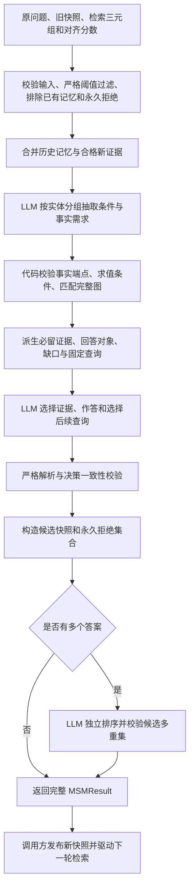

# 成员 D 模块

[English](part_d.md) | [简体中文](part_d.zh-CN.md)

本文说明当前已实现的成员 D 模块。默认流程为需求抽取、代码求值、证据选择与作答、发布前校验，以及多答案独立排序。公开入口是 `manage_memory`，默认使用 `prompt_variant="evidence_decision"`。配置与环境准备见 [README](../README.zn-CN.md#llm-配置)。成员 D 使用受控检索和打分输入配合真实 LLM 验收模块；成员 E 负责 C/E 流水线集成、实际检索和整体运行效果，集成不作为成员 D 模块验收的前置条件。

## 当前默认架构



中间决策不发布记忆。最终输出必须同时满足结构、输入归属、必留证据、条件状态和缺口查询约束；排序也成功后，公开入口才返回可发布结果。任一阶段失败均向上传递异常，调用方继续持有原快照；不补选、补答、改写错误问题或增加业务重试。

条件未知时保护两条分支的已匹配证据，并禁止作答；条件确定后，只保护适用分支和实际条件事实。必要证据漏选会在计算可发布的永久拒绝状态前被拦截。模型仍负责正确理解原问题和抽取需求，本地一致性检查不证明所有抽取语义正确。支持范围和验收边界见[当前验收状态与剩余事项](#当前验收状态与剩余事项)。

## LLM 配置与请求

[`llm_config.py`](../src/agent/llm_config.py) 合并私有 `.env` 与共享 YAML 默认值，并在请求前校验最终配置。共享默认值保持 `gpt-4o-mini` 和 `https://api.openai.com/v1`；本地 DeepSeek 开发及最终切回 OpenAI 的要求见 README。密钥只保存在私有 `.env`，不写入报告或仓库。

[`llm_client.py`](../src/agent/llm_client.py) 提供 `LLMClient.complete(messages, response_format=...)`，使用兼容 OpenAI 的 Chat Completions 协议。配置显式传入，不继承进程代理、凭据等设置。超时、连接失败、HTTP $429$ 和 HTTP $5xx$ 按有限传输重试策略处理；模型、端点和协议不自动回退。调用方负责关闭客户端。

## 逐次请求用量记录

[`llm_usage.py`](../src/agent/llm_usage.py) 为每次实际 HTTP 尝试追加一行 UTF-8 CSV，包括失败和重试。权威账本为 [`logs/llm_usage.csv`](../logs/llm_usage.csv)，列为 `timestamp, model, input_tokens, output_tokens, status, error_type, request_id`。

时间记录请求开始时刻，使用带偏移的 UTC。模型和 token 数优先采用服务返回值；未知 token 数及请求 ID 留空，已报告的零值保留。HTTP 成功后的业务校验失败不改写 HTTP 记账结果。日志不含密钥、提示词、三元组、回复正文或任意异常消息；用量未知不等于零消耗。客户端在发送前检查表头和可写性，追加失败向上传递。并发进程须由调用方串行化 CSV 写入。

## 初始问题分解

[`question_decomposition.py`](../src/agent/question_decomposition.py) 实现 FoG 第 3.1 节和附录 C 图 7 的初始子问题。`decompose_question(question, client)` 默认使用 `explicit_references`：每个问题单独提交检索，写全已知实体名或未知实体的关系描述，不假定前一问已经得到答案，不编造实体名。返回有序问题列表，供调用方分别检索。

`build_decomposition_prompt` 和 `decompose_question` 均接受仅限关键字的 `prompt_variant`；显式 `paper` 保留论文原版措辞及校正后的指令编号。两种变体共享严格解析、传输重试和用量记录，非法输出不自动修复。此增强改善独立指代，实际召回由成员 E 集成验证。

## 潜力子图构建

[`potential_subgraph.py`](../src/agent/potential_subgraph.py) 实现 FoG 第 3.3 节公式 10：$G^{\mathrm{pot}} = \{t \in G^{\mathrm{xpd}} \mid s_t > \tau_p\}$。`build_potential_subgraph(triples, scores, potential_threshold=0.7)` 接收成员 C 在反馈传播后得到的精炼分数，与扩展三元组逐项对齐。

```python
from src.agent.potential_subgraph import build_potential_subgraph

triples = [
    ("Country A", "anthem", "Song C"),
    ("Country A", "led_by", "Person B"),
]
potential = build_potential_subgraph(triples, [0.95, 0.7])
assert potential == [triples[0]]
```

阈值为有限实数，默认 $0.7$，采用严格大于；等于阈值不入选。调用方从 YAML 读取阈值时须显式传入。分数必须是一维、位置对齐的有限实数序列，布尔值无效；张量须先显式转换。图行必须包含三个非空白字符串。所有行先校验再过滤，低分无效行也会报错；证据身份、方向和原字符串不改写。精确重复行只要任一对应分数达标即可进入后续证据集合。

过滤不调用 LLM，也不建立拒绝状态。本轮未提交且不在历史记忆中的证据不会被永久拒绝，后续重新检索和打分达标时仍可使用。

## 问题级持久记忆

[`memory_state.py`](../src/agent/memory_state.py) 提供 `QuestionMemory(original_question, memory_triplets=(), rejected_triplets=())`。每次独立问题运行创建新实例，即使问题文本相同；同一次运行在各轮之间保存快照。持久仅指运行内保留，不包含磁盘存储或全局问题缓存。

原问题必须是非空白字符串并逐字保存。记忆和永久拒绝均复制为 `frozenset[tuple[str, str, str]]`，精确重复项去重，原字符串及边方向不变；两个集合不得重叠。快照及嵌套值不可变，不受调用后修改输入列表影响。新快照由更新流程构造，调用失败不会更改旧快照。

`state.excluded_triplets` 返回当前记忆与永久拒绝的并集。`state.filter_expansion_triplets(candidates)` 按原顺序排除这些完整三元组、精确去重并校验全部候选。共享实体或反转方向不会自动排除另一条边。已吸收记忆不重复展开，但每轮仍独立提交给记忆管理；历史记忆不受本轮检索分数限制。

## 条件证据决策与记忆发布

[`evidence_decision.py`](../src/agent/evidence_decision.py) 实现默认流程的需求抽取与确定性求值。首阶段始终接收原问题，以及历史记忆和合格新证据的完整并集；不先让模型裁剪图。

### 需求抽取与端点绑定

首阶段使用严格结构化输出，`description.kind` 为 `conditional_equals`、`nonconditional` 或 `unsupported`。相等条件描述主体、关系、运算符 `eq`、比较值、原问题中的条件引文及可选单值前提引文。比较值只作为条件约束，不作为已观察事实。

每个分支按 `requirements: [{entity, fact_queries: [{relation, binding}]}]` 组织。`entity` 是原题询问其属性或关系的对象，不是检索到的答案端点；每个查询从所属组继承对象，不重复生成另一份对象字段。条件题提供 `true` 和 `false` 两分支，非条件题提供单一 `branch`。

`observed` 绑定引用本轮完整排序图的稳定三元组编号。代码校验编号、精确关系和目标端点，从端点位置派生出向或入向；多个引用须支持相同方向，自环或角色歧义终止事务。确定方向后仍扫描完整图，收集同一对象、关系和方向的全部匹配事实，避免只保留模型引用的一条。

`missing` 绑定声明待检索方向，不携带预测答案。代码检查两个方向的精确事实：声明方向已有事实时拒绝伪缺口，仅另一方向命中时保守判定冲突；两侧均无命中才允许缺口。此规则可能拒绝合法的另一方向查询，不代表通用关系方向推理。编号只在当前请求内有效，不能跨轮复用。

### 条件求值与必留集合

代码通过完整提交图中的精确主体和关系查找实际条件值。匹配比较值时为 `true`；存在不同值且原题明确单值时为 `false`；否则为 `unknown`。单值前提下出现多个实际值会失败；非条件题状态为 `not_conditional`。缺少事实不自动视为条件不成立。

必留集合由实际条件事实与适用分支的全部匹配事实构成。条件未知时合并两分支，保护已有候选路径；条件确定后只使用对应分支。代码同时派生回答对象、逐项证据匹配及缺失关系，交给最终选择阶段，不依赖模型重新列举必留证据。

### 缺口查询与发布门槛

[`memory_prompt.py`](../src/agent/memory_prompt.py) 的 `build_decision_memory_prompt` 向最终阶段提交原问题、完整证据及派生决策。有缺口时，`missing_relation_queries` 按对象、关系和方向稳定去重，安全引用原字符串，生成以下固定查询：

```text
Which entity does "<target>" connect to through relation "<relation>"?
Which entity connects to "<target>" through relation "<relation>"?
```

最终请求统一使用基础 `MEMORY_RESPONSE_FORMAT` 严格 schema，不生成动态查询枚举。模型通过 `subsequent_question` 原样选择查询；本地校验要求非空、无重复、全部属于本轮允许集合，并包含所有未知条件查询。至多三问，多缺口可以分轮检索；未询问的缺口不会因此变成已满足。

最终输出先经过 `parse_memory_response`，再由 `validate_decision_response` 检查：全部必留证据已选中；条件未知时无答案；条件已确定或非条件题且无缺口时必须作答、不再追问。任何不一致均在返回可继承快照前失败。固定查询保证与派生缺口一致，不能证明模型抽取完整或真实检索必然召回。

### 显式对照接口

`manage_memory` 和 `update_memory` 均默认选择上述完整决策流程。显式 `prompt_variant="paper"` 保留图 8 基线，`retrieval_questions` 保留原检索措辞增强版，`answer_ranking` 保留单次选择的实验对照；默认流程失败时不自动切换这些变体。所有公开 `manage_memory` 变体都保留多答案独立排序。

`build_memory_prompt` 只构造单次选择提示，仍默认 `retrieval_questions`，不代表完整事务入口。它保留论文的高召回、仅依据证据作答和精确复制要求；调用方应使用 `manage_memory` 获得默认发布保护。

## 结构化记忆输出

[`memory_response.py`](../src/agent/memory_response.py) 提供 `parse_memory_response(content, memory_triplets, potential_triplets)`。它是最终输出的基础解析边界，不负责首阶段抽取或完整事务发布。回复必须是完整的标准 JSON 对象，恰有以下三个数组字段：

```json
{
  "selected_triplets": [],
  "predict_answer": [],
  "subsequent_question": []
}
```

全空对象只是格式示例：没有答案时仍须返回 $1$ 至 $3$ 个非空白问题。`selected_triplets` 每行须包含三个非空白字符串，逐字匹配本次实际提交并集中的完整三元组；行内字段位置、方向、大小写、空白及 Unicode 不归一化。`predict_answer` 必须逐字匹配选中三元组的头或尾实体；仅出现在未选中证据、仅作为关系出现或经过改写的答案均被拒绝。空选择只能返回空答案。

返回不可变 `MemoryResponse`，三个字段均为元组，三元组行也为元组。基础解析保留原字符串、行顺序和重复项；默认流程另对追问执行上文的集合与去重校验。缺少、多余或重复字段、代码围栏、额外文字、尾随值、非标准 JSON 数值和越界值全部失败，不修复输出。

解析器能检查任意已选路径的实体归属，但默认需求协议的支持范围另见下文。实体归属不能证明答案语义、完整性或支持强弱，排序也不补齐遗漏答案。直接构造 `MemoryResponse` 容器不会执行这些校验。

## LLM 引导的记忆替换

[`memory_update.py`](../src/agent/memory_update.py) 提供 `update_memory(state, potential_triplets, client)`，负责排序前的决策、最终选择、解析和候选快照构造。新记忆严格等于最终选中三元组的集合；旧证据只有再次选中才保留，不自动与旧记忆取并集。默认必留约束先保护当前需求所需证据，再允许移除已不适用的旧证据。

潜在输入支持空图和生成器，先物化一次，确保所有阶段使用同一份证据。无效状态、图格式错误，或潜在输入与永久拒绝集合重叠时，请求前失败。仅正常完成、未拒绝且通过全部输出及决策检查的事务才构造候选快照。传输和记账错误向上传递。该底层接口不执行独立排序，完整 MSM 应使用下文公开入口。

## 探索效率

设实际提交并集为 $U = G^{\mathrm{mem}} \cup G^{\mathrm{pot}}$，最终选中集合为 $S$，已有永久拒绝为 $R$。通过全部校验后，新记忆为 $S$，永久拒绝更新为 $R' = R \cup (U \setminus S)$。已提交但未选中的新证据和旧记忆均进入永久拒绝，规则在问题运行内持续有效，记忆清空也不重置。

将省略的已提交输入解释为“显式拒绝”是用户批准的复现假设，论文没有明确给出这一映射。已发布的拒绝不会自动解除；默认流程通过发布前的必留校验保护必要证据。格式、决策、一致性、传输或排序失败均不向调用方发布新增拒绝。

调用方在检索和每步展开边界、打分前调用 `state.filter_expansion_triplets`。公开 `manage_memory` 还会在合格潜在输入上应用过滤，保证永久拒绝证据不会再次提交给 LLM。已吸收记忆从旧快照独立补回证据并集。本模块不实现检索器，也不修改成员 C 的打分逻辑。

## 阈值隐藏证据的容错

分数 $s_t \leq \tau_p$、且未在历史记忆中的证据不属于本轮提交并集，不产生永久拒绝。调用方把实际 `response.subsequent_question` 交给检索器，重新展开、过滤并打分后，原隐藏证据只要分数严格超过阈值，仍可重新进入潜在图。恢复依赖再次检索与打分，不自动降低阈值或重新插入事实。

空潜在图合法：仍提交历史记忆；两者都为空时提交空图，缺失关系驱动后续查询。永久拒绝的证据即使高分重输也保持过滤。所有状态按独立问题运行隔离，不因问题文本相同而共享。

## 独立答案排序

[`answer_ranking.py`](../src/agent/answer_ranking.py) 在最终作答产生不少于两个答案时单独调用 LLM。输入仅含原问题、实际选中三元组和实际候选答案，不传检索分数、金标准或未选中证据。零或单答案自动跳过，无关闭排序的业务开关。

排序回复必须正常完成、未拒绝，仅返回 `predict_answer`。候选原字符串和多重集须完全不变，禁止增删、改名或去重；只允许改变顺序，不改变证据、问题、记忆或永久拒绝，也不能补救上游漏答案或漏路径。排序失败时，完整 `manage_memory` 不返回候选快照。`manage_memory_ranked` 是 `manage_memory` 的兼容别名，两者行为相同。

用户已接受排序的工程效果及模型语义限制，并关闭排序调优，不要求开放问题集上零失败。当前调用预算统一见[真实验收入口](#真实验收入口)。

## MSM 重打分轮次接口

[`memory_management.py`](../src/agent/memory_management.py) 提供 `manage_memory(state, triples, scores, client, potential_threshold=0.7)`。成员 C 提供对齐三元组与精炼分数；成员 E 持有问题快照、检索循环、客户端及停止策略。函数本身不读取配置、不检索、不原地修改状态。

```python
from src.agent.llm_client import LLMClient
from src.agent.llm_config import load_llm_config
from src.agent.memory_management import manage_memory
from src.agent.memory_state import QuestionMemory

state = QuestionMemory("Which city was Mira Vale born in?")
client = LLMClient(load_llm_config())
try:
    result = manage_memory(
        state,
        [("Mira Vale", "born_in", "Linden City")],
        [0.95],
        client,
        potential_threshold=0.7,
    )
    state = result.state  # Publish only after every stage succeeds.
    next_queries = result.response.subsequent_question
finally:
    client.close()
```

这段示例会产生真实 API 用量。返回 `MSMResult(state, response)`；仅整体成功后发布 `result.state`，再用 `response.subsequent_question` 驱动下一轮检索。当前默认每轮正常 $2$ 次逻辑请求，多答案为 $3$ 次，各自遵循客户端传输重试及逐次记账。

## LLM 异常与状态保持

默认事务的首阶段、最终阶段和可选排序均属同一公开调用。HTTP、记账、回复封装、严格 JSON、证据或答案归属、决策一致性及排序校验中任一失败，均不返回部分 `MSMResult`。调用方继续持有原快照及既有拒绝集合；输出校验不触发业务重试或备用提供方。如何停止整题、记录失败或稍后显式重试由成员 E 决定。

[`validation_error.py`](../src/agent/validation_error.py) 通过 `ValueError` 子类和固定 `failure_stage`、`error_code` 定位记忆输出失败，覆盖 `evidence_decision`、`decision_consistency` 及基础解析阶段。未识别异常记为 `unclassified`，不复制任意异常消息。HTTP 成功与业务验收成功分别记录。

## 后续子问题

`response.subsequent_question` 是下一轮检索使用的有序字符串元组，不是面向用户的问答。调用方直接传递这些查询，不重新执行初始分解；后续事务仍使用 `state.original_question`。

默认查询由已派生的缺口生成并在发布前校验，规则见[缺口查询与发布门槛](#缺口查询与发布门槛)。无答案时须有 $1$ 至 $3$ 问；有真实缺口时可以分轮补充证据；条件已定且无缺口时必须作答并停止追问。基础解析器保留字符串，不生成替代问题；完整默认事务额外限制允许集合、重复项和未知条件必问项。

## 真实验收入口

[`scripts/validate_part_d.py`](../scripts/validate_part_d.py) 通过公开接口加载真实配置并调用 LLM，仅以受控数据替代 C/E 检索打分，严格阈值为 $0.7$。不修复输出、不增加业务重试，最终关闭客户端。

```text
python scripts/validate_part_d.py --list-cases
python scripts/validate_part_d.py --suite multihop --list-cases
python scripts/validate_part_d.py --suite multihop
python scripts/validate_part_d.py --suite conditional --list-cases
python scripts/validate_part_d.py --suite single
python scripts/validate_part_d.py --suite multi
python scripts/validate_part_d.py --suite removal
python scripts/validate_part_d.py --suite ranking
python scripts/validate_part_d.py --suite conditional
python scripts/validate_part_d.py --suite all
```

`--list-cases` 免费且不读取私有配置；其余命令产生真实用量。默认每个记忆事务最多 $3$ 次逻辑调用，初始分解为 $1$ 次。下表按共享 YAML 当前额外重试 $2$ 次计算 HTTP 上限：

| 验收组 | 用例／事务数 | 逻辑调用上限 | HTTP 尝试上限 |
| --- | --- | --- | --- |
| `single`，含一次分解 | $4$ | $10$ | $30$ |
| `multi` | $4$ | $12$ | $36$ |
| `removal` | $3$ | $9$ | $27$ |
| `ranking` | $2$ | $6$ | $18$ |
| `all`，上述四组 | $13$ | $37$ | $111$ |
| `conditional`，单独运行 | $8$ | $24$ | $72$ |
| `multihop`，单独运行 | $6$ | $18$ | $54$ |

`multihop` 仅使用默认 `evidence_decision`，复用 `single.sufficient`、`single.insufficient`、`single.empty`、`multi.partial`、`multi.recovery`、`multi.exclusion_probe` 的事实及实际返回快照，不运行分解或独立隔离用例。正常为 $12$ 次逻辑调用；上表保守计入可选排序和额外两次传输重试。共用 `check_two_hop` 检查完整两跳抽取、必留路径、精确答案／空答案、具体允许查询、阈值隐藏事实、恢复及两阶段实际提交图；同一检查也用于默认 `single`、`multi` 和 `all` 中的六例，显式旧提示对照保留原行为。缺失关系仅接受脚本中列出的有限语义别名；图中已有关系必须精确匹配。不要求选择或拒绝无关干扰边；`distractor_rejection` 和 `multihop_observations` 单独记录自然拒绝及过滤是否已观察到，未拒绝时明确为 `not_observed`。任何必需断言失败立即停止、退出码为 $1$，不继承失败轮候选快照；成功事务保留原始抽取供人工审阅。新增入口已通过离线检查，尚未做真实两跳验收。

`conditional` 不加入 `all`，对 Silver／Bronze 各执行一张独立完整图和一条从空快照开始的三轮链。首轮只给两条出生地，次轮真实继承快照且仅补出版社，末轮以 $0.95$ 重输全部事实。逐轮检查完整记忆、答案、每条查询、永久拒绝及提交前过滤；失败即停。自动检查仍需人工审阅原始需求抽取、方向、条件语义及证据支持。

显式 `--prompt-variant paper` 或 `--prompt-variant retrieval_questions` 可运行对照；对应 `all` 仍为最多 $25$ 次逻辑调用、$75$ 次 HTTP 尝试，不自动回退。`reference_diagnostic`、`clarification_diagnostic` 和 `empty_diagnostic` 为独立诊断组，可免费预览各自预算，均不加入 `all`。

每次运行保存唯一的私有 `tmp/tmp_part_d_validation_<UTC timestamp>.json`，包含受控输入、实际查询、有效输出、成功事务的分阶段请求与 schema、原始完成回复及前后快照。失败只保存异常类及固定诊断，不保存失败原文、密钥或任意异常消息。实际 HTTP 用量继续写入共享账本；报告不提交仓库。退出码 $0$ 表示结构、状态及该组自动检查通过，`semantic_review` 仍待人工审阅。

## 当前验收状态与剩余事项

2026/11/09，当前默认架构已完成采用。GPT-4o 的两张完整条件图和两条三轮链已通过受控验收，覆盖未知时保留候选路径、条件确定后的正确答案、只移除无关旧证据和高分重输后的永久过滤。两条链共 $6$ 次事务、$12$ 次 HTTP 尝试，无失败、重试或排序请求，实际模型均为 `gpt-4o-2024-08-06`。这些结果支持关闭本轮条件证据保留、作答与旧记忆移除排查。

默认采用经全部 $117$ 项离线回归，以及既有 $8$ 次已验收事务、$16$ 个阶段的免费精确重放，核对请求消息、schema、答案、查询和前后快照完全一致。私有复核汇总为 `tmp/tmp_step5_replay.json`，实际用量以共享账本为准。本次文档清理不新增 API 请求，不修改实现、私有配置或账本。

当前协议支持非条件单跳需求、单关系相等条件，以及 `nonconditional_path` 非条件两跳线性路径。路径从原题中的 `root_entity` 开始，按两个 `steps` 的精确关系和方向遍历完整提交图，保护全部可达前缀；仅为当前可达实体生成缺口查询。任一候选有缺口时禁止作答，无缺口时答案只能来自代码派生的终跳 `answer_candidates`。自环和仅反向命中以固定诊断失败。其他多跳、聚合和复杂需求仍为 `unsupported`。原题理解、需求完整性和关系语义依赖 LLM，两跳真实验收尚未完成；受控 GPT-4o 通过不代表开放问题集上的稳定性。

TODO 2.3.5 的独立 GPT-4o-mini/OpenAI 模块验收保持待办，不能由 GPT-4o 结果替代；原有 `all` 中的两跳用例仍保留为回归，不能预先视为通过。TODO 2.3.6 的历史用量核对和 2.4 最终交付也尚未完成。实际 C/E 接线与召回由成员 E 验证，不作为成员 D 模块验收前置条件。已删除的排查过程保留在 Git 历史和私有原始报告中，本文只维护当前架构、已确认结果及剩余事项。

### 多跳问题与新默认协议不兼容

原有验收要求模块沿“书 → 作者 → 出生城市”的两跳路径作答，但新默认 `evidence_decision` 只描述已知对象的一跳需求，并明确要求将多跳标为 `unsupported`。模型按提示返回该类型时，代码会以 `decision_unsupported` 终止，无法继续保留路径、追问或作答。这是协议与既有用例的兼容问题，不只是模型答错。

**受控用例**

原问题为 `Which city was the author of The Glass Orchard born in?`，正确答案为 `Linden City`。输入事实如下；阈值为 $0.7$，只有严格高于阈值的新事实才提交给模型。

```text
AUTHOR     = ("The Glass Orchard", "written_by", "Mira Vale")
BIRTH      = ("Mira Vale", "born_in", "Linden City")
DISTRACTOR = ("The Copper Harbor", "written_by", "Nolan Reed")
```

| 用例 | 输入与预期行为 |
| --- | --- |
| `single.sufficient` | 空快照，提供 `AUTHOR`、`BIRTH`，分数均为 $0.95$。保留两条路径事实，回答 `Linden City`，不再追问。 |
| `single.insufficient` | 空快照，仅提供 $0.95$ 的 `AUTHOR`。保留作者事实，不回答，追问 `Mira Vale` 的出生城市。 |
| `single.empty` | 空快照、空图。不回答，先追问书的作者；不能编造作者名或城市。 |
| `multi.partial` | 空快照，依次提供三条事实，分数为 $0.95$、$0.7$、$0.95$。保留 `AUTHOR`，追问出生城市；`BIRTH` 未提交，不能被永久拒绝。 |
| `multi.recovery` | 继承上一轮实际快照和查询，三条事实均改为 $0.95$。补回 `BIRTH`，保留完整路径并回答 `Linden City`；已永久拒绝的干扰事实仍须过滤。 |
| `multi.exclusion_probe` | 继承恢复轮快照，再次以 $0.95$ 输入三条事实。路径和答案保持有效，已永久拒绝的干扰事实不能重新提交。 |

这些用例位于 [`scripts/validate_part_d.py`](../scripts/validate_part_d.py) 的 `QUESTION`、`CASES` 和 `run_cases`；`single`、`multi` 均包含在 `all` 中。`multi.independent` 是独立的一跳隔离用例，不是本问题的两跳复现。干扰事实只有实际提交且被省略后才进入永久拒绝，不能预先假定模型一定将其拒绝。

**已观察到的表现与证据边界**

- 旧默认单次选择流程曾使用 `deepseek-flash` 通过上述单轮和多轮场景：完整图保留两跳并回答 `Linden City`；只有作者时保留作者并追问出生城市；空图追问作者；阈值隐藏的出生事实在下一轮恢复，干扰事实被拒绝后持续过滤。历史结果见[旧版单轮记录](https://github.com/yyht6300a/AI6103-Project-FoG/blob/b7f4faac112fca370499803c7242ac23d6675d72/docs/part_d.zh-CN.md#单轮真实验收结果)，亦可查阅[英文单轮与多轮记录](part_d.md#single-round-live-result)。这些结果不能算作新默认通过。
- 新默认的已验收 GPT-4o 条件题直接点名 `Mira Vale`、`Nolan Reed`，只需读取各自的一跳出生事实；它们没有验证从书推导作者再查询出生地的能力。
- 新默认对上述两跳用例尚无已确认的真实通过结果。原记录中的 `unsupported → decision_unsupported` 来自提示和解析逻辑；下方归因已用合成回复核实默认入口的终止、漏保留和错误答案放行边界，不代表真实模型一定生成这些回复。本次不调用 API。
- 旧记录引用的私有报告 `tmp/tmp_part_d_validation_20261108T163125709480Z.json`、`tmp/tmp_part_d_validation_20261108T163553245365Z.json` 当前工作区不存在；历史表现依据已提交文档，不能声称已重新核验原始回复。

**定位入口与修复边界**

协议与求值入口为 [`evidence_decision.py`](../src/agent/evidence_decision.py) 的 `DECISION_INSTRUCTIONS`、`decode_description`、`resolve_query` 和 `derive_decision`；发布边界见 [`memory_update.py`](../src/agent/memory_update.py) 与 [`memory_management.py`](../src/agent/memory_management.py)。下方方案沿这些入口修复，不另建流水线。

[`tests/test_memory_response.py`](../tests/test_memory_response.py) 的多跳实体归属测试和 [`tests/test_memory_update.py`](../tests/test_memory_update.py) 的路径选择测试仅覆盖各自使用的解析或选择流程，不能替代新默认完整事务的多跳验收。免费入口为 `python scripts/validate_part_d.py --suite single --list-cases` 和 `python scripts/validate_part_d.py --suite multi --list-cases`；去掉 `--list-cases` 会产生真实 API 用量。

方案以这些受控用例达标为目标，保留现有条件题的证据保护、严格阈值、永久拒绝和失败不发布规则。不要求开放问题集零失败，不把不同模型效果一致或 GPT-4o-mini 达到其他模型水平作为修复目标；TODO 未完成项和 C/E 集成不列为本问题的排查内容。以下是待实施方案，不表示代码已修复或真实验收已通过。

#### 归因：协议缺少依赖，发布校验只能保护已抽取需求

2026/11/09 对当前代码进行了静态检查，并以合成结构化回复通过公开 `manage_memory` 免费核实边界。私有复现脚本为 `tmp/tmp_multihop_attribution.py`；它不加载 `.env`、不发 HTTP 请求、不改账本。结论如下。

| 层次 | 当前机制及归因 |
| --- | --- |
| 直接阻断 | `DECISION_INSTRUCTIONS` 明确禁止多跳；`decode_description` 收到 `unsupported` 后立即抛出 `decision_unsupported`。合成回复证实只调用首阶段，最终选择不执行，旧快照保持。重试、换模型或降低阈值不能补上协议能力。 |
| 表达缺口 | `BRANCH_SCHEMA` 和 `decode_branch` 将每组 `entity` 变成独立的固定 `target`；`resolve_query` 只能对该字符串查一条关系，`derive_decision` 不会把上一跳的另一端绑定为下一跳对象。多个实体组是并列需求，不等于路径依赖。 |
| 漏保留与永久损失 | `Mira Vale` 出现在图中，因此只抽取其 `born_in` 仍通过对象归属检查。此时 `required_triplets` 只有 `BIRTH`，`missing_relations` 为空；只选择 `BIRTH` 并回答 `Linden City` 可以通过完整默认事务，随后 `update_memory` 将未选的 `AUTHOR` 永久拒绝。已免费复现；这是抽取缺项逃过校验后的结果，不是阈值或拒绝集合公式算错。 |
| 空图与中间实体未知 | 空图中不能合法填写尚未观察到的 `Mira Vale`，现有结构又没有“第一跳结果”这个对象。把题中 `author of The Glass Orchard` 当成 `entity` 只会通过字符串子串归属，生成以这段描述为字面实体的出生地查询；合成求值已确认。字符串在题中不证明它已绑定到图实体。 |
| 答案校验不足 | `parse_memory_response` 只证明答案是所选图的某个端点。合成回复中，选择 `BIRTH` 并回答人物 `Mira Vale` 也能通过默认事务。必须增加路径终点约束，不能把端点归属误当作路径推理正确。 |
| 验收盲区 | `memory_round` 检查结构、旧快照不变及拒绝集合公式；`single` 未逐例断言路径和答案，`multi_observations` 中的恢复等布尔值也未统一作为失败门槛。即便脚本退出码为 $0$，上述语义错误仍可能存在。条件组已有专门断言，不能替两跳组覆盖。 |

完整图上若人为列出“书的作者”和“作者的出生地”两个实体组，现有求值可以将两条边都加入必留集合，漏选会被 `decision_required_omitted` 拦截；合成检查也已确认。因此现有保护机制可复用，真正缺失的是从原题根实体出发的依赖表达和求值。只删除多跳禁令、要求“高召回”或多列几个已知实体，均不能覆盖空图、未知作者及跨轮恢复。

#### 修复选择：增加受限两跳路径协议

保留 `evidence_decision` 默认入口、现有单跳与相等条件描述，新增明确的 `nonconditional_path` 描述变体，先只支持本问题所需的非条件两跳线性路径；聚合、递归和条件内多跳仍明确不支持。路径长度先严格限制为 $2$，不顺带实现通用查询语言或任意依赖图。

首阶段仍只调用一次 LLM：抽取题中根实体及按顺序排列的关系和方向，不填写中间实体名、预测答案或自行判断路径已满足。第 1 步已实现以下协议，第 2 步已完成离线场景门槛，第 3 步已补齐验收脚本断言；真实验收待第 4 步完成。

```json
{
  "description": {
    "kind": "nonconditional_path",
    "root_entity": "The Glass Orchard",
    "steps": [
      {"relation": "written_by", "direction": "outgoing"},
      {"relation": "born_in", "direction": "outgoing"}
    ]
  }
}
```

`root_entity` 必须逐字来自原题，避免用检索到的人名跳过根路径；关系在图中已出现时使用精确关系名，缺失时仍由模型描述待检索关系，与现有缺口语义一致。严格 schema 和本地解析同步约束字段、非空字符串、方向枚举和步数。路径方向由模型抽取，代码只能验证实际连接，不能证明自然语言关系方向理解正确；两跳受控断言和人工审阅仍不可省略。

不把新路径强塞进旧 `entity` 字符串或旧 `observed` 编号绑定：中间实体未知时无法提供这种绑定。新增路径由代码统一对完整图求值；原有单跳端点绑定、条件求值及其保守冲突规则继续按原分支执行。模型若仍将原题错误压成旧单跳描述，本地结构校验无法普遍识别该语义遗漏；本题验收必须检查抽取确实包含两跳，不能因为最终城市碰巧正确就通过，也不为此硬编码书名或问题文本。

#### 路径求值、缺口与发布规则

在 `evidence_decision.py` 增加独立的受限路径求值分支，输入仍为历史记忆与合格新证据的完整并集；内部复用 `required_triplets`、`missing_relations`、`query_matches` 和现有查询渲染，另给路径决策提供代码派生的终跳 `answer_candidates`。不更改公开 `MSMResult`、`QuestionMemory` 或最终三数组回复格式。

1. **从根实体逐跳连接**：第一跳只匹配 `The Glass Orchard` 的 `written_by`；下一跳对象只能取这些实际三元组的另一端。按声明方向精确匹配关系及端点，不反转、补造或改写三元组。图中单独存在某人的出生事实，不能证明他是这本书的作者。
2. **保护所有已匹配前缀**：每一步扫描完整提交图，保留所有可达候选对应的路径边，并将其并入 `required_triplets`。未完成的前缀也必留，不能只保护最终出生地。若同一书匹配多个作者，不任取第一条；对每个实际作者继续求值，某条前缀尚有缺口时保守地暂不发布答案。
3. **只询问当前可解析的缺口**：没有作者边时，只生成根实体的作者查询，下游出生地步骤保持待解析，不生成虚构人名或描述占位实体。已有 `AUTHOR` 而无 `BIRTH` 时，生成 `Mira Vale` 的出生地查询。使用现有固定查询模板、去重和至多三问规则；某个候选缺失不妨碍继续保护其他候选已有的路径。声明方向未命中而仅反向命中时按保守冲突报错，自环也报错，不能静默翻转方向。
4. **约束路径答案**：路径尚有缺口时禁止 `predict_answer`；完整时必须回答且停止追问。每个答案必须来自从根实体真实走完两跳所得的 `answer_candidates`，不能只检查它出现在某条所选边上。终跳约束只作用于新路径变体；既有单跳和条件题契约不扩大修改。
5. **在拒绝计算前失败**：最终阶段仍由 LLM 选择原始证据并作答；代码只校验，不自动补选或补答。漏掉任一必留前缀、跳过缺口、答中间人物或答不相连城市，均须在计算可发布永久拒绝集合前抛出固定诊断。沿用最终排序成功后才返回的事务边界，任一步失败都保留原快照。
6. **保持跨轮语义**：每轮用原问题和实际继承快照重新求值，不保存跨轮证据编号，也不新增路径缓存。`BIRTH` 分数为 $0.7$ 时既不参与求值，也不进入拒绝集合；升至 $0.95$ 后可与旧 `AUTHOR` 接通。已有永久拒绝继续在请求前过滤，不能借修复清空拒绝状态。已误拒绝 `AUTHOR` 的旧运行无法靠重新输入恢复，应从新 `QuestionMemory` 重跑该题，不能宣称新代码会自动纠正历史快照。

#### 最短实施与验收顺序

1. **先修协议与求值**：同步修改 `evidence_decision.py` 的提示、严格 schema、本地解码和受限路径求值；在 `memory_prompt.py`、`validate_decision_response` 中接入前缀、缺口及终跳候选约束，新增诊断时登记到 `validation_error.py`。`memory_update.py` 和 `memory_management.py` 原则上只需核对现有流程是否已转发新决策，不重写事务、阈值、拒绝或排序机制。当前归因已经有免费证据，不先花钱重复证明旧协议不支持多跳。

   > 2026/11/09：第 1 步已实现。新增严格两跳结构及本地解码、完整图逐跳求值、全部前缀保护、可达缺口与终跳答案约束，登记四个固定诊断。已核对现有更新和公开入口转发完整决策，并在拒绝计算和最终排序发布前执行校验；调用预算不变。现有离线测试 $117$ 项通过，未调用真实 API。可以进入第 2 步，补齐公开默认入口的六场景和反例门槛；本记录不代表两跳真实验收或独立交付完成。

2. **用公开默认入口完成离线门槛**：在 `tests/test_evidence_decision.py` 等现有测试中用合成首阶段和最终回复覆盖上表六个场景，真实继承每轮返回快照；另补两个有区分力的反例：有出生事实但缺少作者连接时只能问作者；正确路径旁有不相连出生事实时不能据此作答。覆盖两条作者候选中一条尚缺出生地，确认不会只凭另一条完整路径提前作答。分别注入漏选作者边、错误终跳答案和无效路径结构，检查抛错位置与旧快照保持；另检查已有精确连接时不会产生伪缺口。对真正已拒绝干扰边的过滤用合成快照验证，不能要求真实 LLM 必然拒绝可选干扰边。

   > 2026/11/09：第 2 步已完成。`tests/test_evidence_decision.py` 新增 `TwoHopDefaultEntryTests` 的 $8$ 项测试，以合成首阶段和最终回复通过公开默认 `manage_memory` 覆盖 `single.sufficient`、`single.insufficient`、`single.empty`、`multi.partial`、`multi.recovery`、`multi.exclusion_probe`，多轮真实继承返回快照及查询。逐轮核对两阶段完整提交图、必留前缀、可达缺口、终跳候选、精确答案／查询及拒绝集合；阈值等于 $0.7$ 的出生事实不提交、不拒绝，升至 $0.95$ 后接通旧记忆，已有精确连接不产生伪缺口。补齐断开出生事实、无关城市、双作者一条缺证据的反例，并用预置拒绝快照确认高分干扰边在两阶段请求前过滤，不依赖真实模型主动拒绝。漏选作者边、回答中间人物／不相连城市、缺口时提前回答、错误查询及 $13$ 种无效路径结构均被对应阶段拦截，未构造新快照，旧记忆和永久拒绝保持。定向命令 `python -m unittest discover -s tests -p test_evidence_decision.py -v` 的 $21$ 项及完整命令 `python -m unittest discover -s tests -v` 的 $125$ 项全部通过；未调用真实 API，未修改生产逻辑、私有配置或共享用量账本。可以推进第 3 步，补齐维护验收脚本的 `multihop` 组及失败断言；真实两跳验收和 TODO 2.3.5 独立交付仍待办。

3. **补齐同一组用例的验收断言**：在 `scripts/validate_part_d.py` 复用现有事实和轮次，增加只运行上述六个场景的 `multihop` 组，保留 `single`、`multi` 的既有入口；共用两跳检查函数，避免复制两份预期。把必需路径、精确答案、空答案、具体允许查询、阈值隐藏事实未拒绝、恢复及已拒绝事实未重新提交设为失败门槛。完整图要求包含 `AUTHOR`、`BIRTH` 并回答 `Linden City`；空图问作者；部分图保留 `AUTHOR` 并问 `Mira Vale` 的出生地。不把是否选中无关干扰边设为修复成败条件；若它从未被拒绝，报告应明确未观察到该项自然拒绝，不能冒称过滤已实测。失败立即停止，不继承失败轮结果。

   > 2026/11/09：第 3 步已完成。新增 `--suite multihop`，仅复用指定六例，保留默认 `single`、`multi` 入口并共用 `check_two_hop`。必留路径、精确答案／空答案、具体允许查询、完整两跳抽取、阈值隐藏事实未提交且未拒绝、继承恢复及两阶段实际提交图均成为失败门槛；失败立即停止，CLI 返回 $1$，不继承失败轮候选结果。干扰边可保留也可拒绝，报告分别记录自然拒绝和过滤覆盖；从未拒绝时明确 `not_observed`。新增离线测试覆盖六例真实快照／查询交接、自然拒绝与始终保留干扰边两种情况、碰巧答对的错误单跳抽取及逐项断言故障；脚本层 $11$ 项、完整离线 $129$ 项全部通过。免费命令 `python scripts/validate_part_d.py --suite multihop --list-cases` 确认六例和 $18$ 次逻辑调用上限；按额外两次传输重试，HTTP 上限为 $54$ 次。未调用真实 API，未修改生产模块、私有配置或共享账本。可以推进第 4 步，在 GPT-4o-mini/OpenAI 上执行一次有界真实验收并人工审阅抽取；真实两跳效果、条件冒烟和 TODO 2.3.5 独立交付仍待后续步骤。

4. **离线通过后才做有界真实验证**：先运行新增路径测试及 `python -m unittest discover -s tests -v`，确认现有条件保护、严格阈值、永久拒绝和排序失败不发布均未回归。再用维护入口免费预览新组，随后只执行一次六场景真实验收，使用私有配置中的 GPT-4o-mini/OpenAI，不加业务重试、不换模型做效果竞赛。六次事务正常为 $12$ 次逻辑调用；按现有每事务最多三次及额外两次传输重试，保守上限为 $18$ 次逻辑调用、$54$ 次 HTTP 尝试。第 3 步已提供 `--suite multihop`；其离线通过及免费预览不代表真实验收已完成。

   > 2026/11/09：已执行第 4 步，验收未通过。使用项目 conda 环境运行新增路径测试 $21$ 项及完整离线回归 $129$ 项，全部通过；免费预览确认六例及 $18$ 次逻辑调用上限。随后仅运行一次 `python scripts/validate_part_d.py --suite multihop`，实际模型为 `gpt-4o-mini-2024-07-18`，端点为 OpenAI。首例 `single.sufficient` 在首阶段触发 `evidence_decision / decision_conflict`，CLI 返回 $1$ 并立即停止；旧空快照保持不变，未发布记忆或永久拒绝，未执行最终选择、排序、其余五例或条件冒烟。共享账本新增 $1$ 次成功 HTTP 请求，输入 $1284$、输出 $126$ tokens，无失败或重试；HTTP 成功不代表业务验收通过。私有报告为 `tmp/tmp_part_d_validation_20261109T120233376333Z.json`，逐次用量与调用计数核对通过，私有 `.env` 哈希未变。失败报告按现有策略不保存原始回复，因此不能人工审阅本次抽取，也不能断言具体关系、方向或题型错误；该诊断对应已有事实与缺口声明冲突，或单值条件出现多个值，尚需定位实际触发分支。不能推进第 5 步；下一项按第 6 步定位首阶段冲突，修复后只复验失败场景及受影响依赖链，不重跑完整批次或更换模型。TODO 2.3.5 独立交付验收保持待办，未修改生产代码。

   **第 4 步补充归因与处置方案**

   > 2026/11/09 执行结果：已修正首阶段提示的四类路由，明确两跳依赖即使已知中间实体也必须使用 `nonconditional_path`，并加入不同实体示例；未修改 schema、求值器或发布契约。同一验收入口新增可重复的 `--case`，支持 `multihop`／`conditional` 的既有用例、保留原顺序，遗漏前置依赖时在加载配置前失败。受控两跳首阶段业务失败时保存经生产解码、字段词汇和长度限制的投影及精确命中编号；无效／未知文本只记 `unavailable`，不保存原始失败回复。新增单例执行、依赖拦截、假缺口投影及敏感文本排除测试，完整离线 $131$ 项通过；字符扫描通过。免费预览 `--suite multihop --case single.sufficient --list-cases` 确认仅一例，最多 $3$ 次逻辑调用／$9$ 次 HTTP。
   >
   > 仅复验 `single.sufficient`，使用 `gpt-4o-mini-2024-07-18`／OpenAI，仍在首阶段触发 `evidence_decision / decision_conflict`，立即停止。私有报告 `tmp/tmp_part_d_validation_20261109T122246762856Z.json` 的投影确认本次实际错误：`kind=conditional_equals`；把书的 `written_by=Mira Vale` 当作条件，把整句原题当作 `condition_quote`；`true` 分支引用编号 $0$ 的出生事实，`false` 分支却把同一人的 `born_in` 标为 `missing/outgoing`，完整图编号 $0$ 精确命中，触发假缺口校验。此证据只说明本次回复，不能还原上一次历史失败。未执行最终选择、排序或后五例，旧空快照及拒绝集合不变。共享账本仅新增 $1$ 次成功 HTTP，输入 $1395$、输出 $135$ tokens，调用计数相符，无重试；私有 `.env` SHA-256 前后相同。
   >
   > 不能推进第 5 步。下一项仍是第 6 步的首阶段修复：明确关系依赖／定语从句不是分支条件，`conditional_equals` 必须有原题显式真假分支，禁止从图中关系构造条件；保留已有两跳路由和严格校验。补充本次实际错误结构的免费回归后，只再次复验首例，新增预算单独列明；通过后才运行剩余五例及条件完整图冒烟。不改求值器，不自动把旧结构转换成路径，不重复相同提示调用。TODO 2.3.5 独立交付验收保持待办。

   **执行后再归因与下一轮方案**

   > 2026/11/09 执行结果：已实施条件准入修订，仅修改 `DECISION_INSTRUCTIONS`，增加依赖题与真实条件题对照，明确比较值来自原题、禁止由图制造条件和由定冠词补出单值前提；schema、解码、求值及发布规则保持原契约。新增实际错误结构与“仅修假缺口仍抽错类型”的免费回归，原错误保持 `decision_conflict`／一次调用／旧快照不变，反事实仍被 `two_hop_extraction` 拦截；完整离线 $132$ 项通过，字符扫描通过。条件准入方案已执行到真实复验；后续以本记录下方的最新归因与方案为准。
   >
   > 首例报告 `tmp/tmp_part_d_validation_20261109T123849256549Z.json`：GPT-4o-mini／OpenAI 实际返回 `nonconditional_path`，根为 `The Glass Orchard`，路径为 `written_by/outgoing → born_in/outgoing`；两边必留、无缺口、唯一候选及答案为 `Linden City`、无后续查询，全部受控断言通过，实际 $2$ 次请求。随后报告 `tmp/tmp_part_d_validation_20261109T123903269418Z.json`：`single.insufficient`、`single.empty`、`multi.partial`、`multi.recovery` 通过，恢复轮真实继承部分轮快照和查询；干扰边已在部分轮自然拒绝，隐藏出生边未被提交或拒绝，恢复轮成功作答。空图实际将首关系命名为 `author`，其余路径使用 `written_by`；空图允许描述缺失关系，受控检查通过，但实际检索召回仍未验证。
   >
   > 最后一例 `multi.exclusion_probe` 首阶段失败，立即停止，未执行条件冒烟。受限投影为正确题型和根实体，但路径是 `written_by/outgoing → born_in/incoming`；提交图中的出生事实为 `Mira Vale → born_in → Linden City`，从作者继续应使用 `outgoing`。反向声明触发 `evidence_decision / decision_path_conflict`，未进入最终选择或排序，旧快照（两条记忆及一条永久拒绝）保持不变。此次是方向抽取错误，不能归因为条件误判复发或拒绝过滤失效；模型内部原因未知。路径段尚未明确说明方向相对于“当前可达节点”，现有 head/tail 说明位于仅适用于分组一跳绑定的段落，这是下一处可针对性修订的提示边界。
   >
   > 本轮累计新增 $11$ 次逻辑调用／成功 HTTP，无重试，账本新增 $11$ 行，输入 $14055$、输出 $457$ tokens；实际模型均为 `gpt-4o-mini-2024-07-18`。私有 `.env` SHA-256 前后相同。不能推进第 $5$ 步；TODO 2.3.5 独立交付关卡保持待办。方向修订、依赖链复验及追加预算以下方最新方案为准。

   **最新归因：第二跳方向抽反，过滤与事务保护正常**

   2026/11/09：核对 `tmp/tmp_part_d_validation_20261109T123849256549Z.json`、`tmp/tmp_part_d_validation_20261109T123903269418Z.json`、对应账本行及当前实现，用私有 `tmp/tmp_step4_direction_attribution.py` 免费重放最新失败和方向反事实。未读取 `.env`、调用 API、修改生产代码或账本。下文取代已执行的条件准入方案，针对最新 `multi.exclusion_probe` 失败；此前无投影的首次失败仍不能还原，不将本次原因回填历史。

   | 层次与证据 | 结论及处置 |
   | --- | --- |
   | **本轮进展**：首例及随后四例通过，最新失败投影也是 `nonconditional_path`，根实体和两个关系均正确。 | 条件准入修订在本轮六例中均选对路径类型；本次只错第二跳方向。不能继续把条件误判、协议不支持两跳或缺少 `--case` 当作当前阻塞，也不能据此宣称题型抽取普遍稳定。 |
   | **输入与状态**：失败轮继承恢复轮两条记忆和一条永久拒绝；三条重输事实分数均为 $0.95$。记录的 `submitted` 只有 `AUTHOR`、`BIRTH`，不含 `DISTRACTOR`。 | 新展开过滤会排除已有记忆与拒绝，但完整提交图重新并入历史记忆。必要边没有丢失，干扰边已过滤；不能将“没有合格新边”误作空图，也无需改阈值或清空拒绝集合。 |
   | **直接触发点**：第一跳 `written_by/outgoing` 将当前节点从书推进到 `Mira Vale`；第二跳为 `born_in/incoming`。图中只有 `Mira Vale → born_in → Linden City`。 | `derive_path_decision` 对 `incoming` 查尾端，找不到尾为作者的出生边，却在头端找到该关系，命中“声明方向无事实、仅反向有事实”的 `decision_path_conflict`。没有自环，不是假缺口条件分支或多值冲突；最终选择和排序未执行。 |
   | **免费反事实**：原投影经公开 `manage_memory` 重放仍在首阶段失败，只调用一次、旧快照不变。仅将第二跳改为 `outgoing` 后，两条必留、无缺口、唯一候选 `Linden City`；复用已保存的有效最终回复，完整事务通过，原记忆及拒绝不变。另将出生边反转后，原 `incoming` 路径也能正常求值。 | 当前方向求值符合契约；修复应落在抽取提示。不能把所有方向固定成 `outgoing`，也不能自动翻转冲突或补答。后两个成功均为合成反事实，不算真实模型复验。 |
   | **提示边界与证据限度**：head/tail 定义位于明确只适用于分组一跳绑定的段落；路径段只列出方向枚举和顺序，没有逐跳当前节点的操作定义。按当前代码重建失败轮首请求，与已保存的成功首例及恢复轮消息、schema 相同。 | 路径方向的参照点缺少明确说明，是可直接修正的提示缺口。相同请求已有成功输出，说明并非每次都抽错；不能据此断定模型内部原因或声称补一句提示就能稳定解决。失败报告未保留原始请求，重建一致不等于独立核验了当时请求原文。 |
   | **故障边界与用量**：真实报告确认旧快照不变；对应 $11$ 行账本均为成功 HTTP，合计输入 $14055$、输出 $457$ tokens，与两个报告的 $2+9$ 次逻辑调用相符。 | HTTP 成功与业务通过分开记录。本次不支持网络、重试、排序、过滤或发布事务故障的归因；不再排查这些已被证据排除的方向。 |

   **最短修复与复验方案（待实施）**

   > 2026/11/09 执行结果：已在 `DECISION_INSTRUCTIONS` 路径段补充逐跳当前节点、头尾端方向、移到另一端再判下一跳的操作定义，以及 `owns/incoming → headquarters/outgoing` 和 `owned_by/outgoing` 对照例；明确已有图按精确关系和端点判方向，缺图不编造中间实体。条件准入、schema、求值、最终提示、拒绝及发布规则未改。新增恢复快照回归验证原第二跳反向声明在首阶段以 `decision_path_conflict` 失败、仅一次调用、投影保留错误方向、两条记忆及一条拒绝不变；仅修正第二跳及实际反转出生边的对照均经公开事务成功，防止将方向一律固定为出向。完整离线 $133$ 项通过，语法检查通过。
   >
   > 免费预览确认真实依赖链仅含 `multi.partial → multi.recovery → multi.exclusion_probe`，上限 $9$ 次逻辑调用／$27$ 次 HTTP 尝试。从空快照执行一次，首轮 `multi.partial` 即失败并停止，报告为 `tmp/tmp_part_d_validation_20261109T142220796878Z.json`。实际模型 `gpt-4o-mini-2024-07-18`／OpenAI；受限投影是 `nonconditional_path`，根 `The Glass Orchard`，步骤 `written_by/incoming → born_in/outgoing`。本轮提交图只有两条作者边，出生边分数等于阈值，未提交且未拒绝；从书出发应沿 `written_by/outgoing` 到作者，模型第一跳抽反，代码触发 `evidence_decision / decision_path_conflict`。未进入最终选择、恢复轮或排除探测轮，空旧快照保持不变。
   >
   > 新旧提示差异仅为上述路径方向操作定义和混合方向例；旧失败错第二跳，新失败错第一跳，题型、根和关系名称正确。本次说明补充后仍未解决逐跳方向抽取可靠性，不能归因为求值、阈值或拒绝过滤失效，也不能推断模型内部原因。未重复发送相同提示、叠加提醒或追加预算；后续须先针对第一跳未解决字段决定具体变更，再另列复验预算并从链首重建。
   >
   > 账本新增 $1$ 行成功 HTTP，对应 $1$ 次逻辑调用，无重试，输入 $1768$、输出 $40$ tokens；HTTP 成功不代表业务通过。私有 `.env` SHA-256 前后相同。三个独立场景与条件冒烟均未执行，**不能推进第 $5$ 步**；TODO 2.3.5 仍待办。上方“待实施”为原计划状态，本引用块记录此次实际执行及停止位置。

   1. **只补路径方向的操作定义**：直接修改 `src/agent/evidence_decision.py` 的 `DECISION_INSTRUCTIONS` 路径段。初始当前节点是 `root_entity`；每跳方向相对于该跳当前可达节点，当前节点是三元组头端则 `outgoing`，是尾端则 `incoming`，下一节点取另一端，再判断下一跳。已有图时依据精确关系及当前端点判断，不按题目被动语态、问句词序或最终答案的位置猜方向；证据缺失时描述原题所需的关系和方向，不编造中间实体。用其他实体补一个混合方向例：图为 `Helios Ltd → owns → Aurora Tower`、`Helios Ltd → headquarters → Northport`，从塔询问所属公司总部时应为 `owns/incoming → headquarters/outgoing`；若第一条表示为 `Aurora Tower → owned_by → Helios Ltd`，则第一跳为 `owned_by/outgoing`。保留已有效的条件准入、四类路由和两跳约束；不改 schema、解码、求值器、最终提示、拒绝或发布规则，不新增分类调用、自动纠错或业务重试。实现时同步中英文模块说明。

   2. **补一个实际失败回归，再跑现有离线检查**：在现有 `tests/test_part_d_validation.py`／`tests/test_evidence_decision.py` 用例中复用最新投影和恢复轮快照，核对 `outgoing → incoming` 触发 `evidence_decision / decision_path_conflict`、一次调用、不执行最终阶段、两条记忆及一条拒绝保持，并确认受限投影保留错误方向。同组对照只改第二跳为 `outgoing`，应派生完整路径、无缺口、唯一城市，并通过公开事务；补一组图确实支持 `incoming` 的路径，防止修成全出向。复用既有六场景、条件保护及发布门槛，不重建诊断或复制整套路径测试。运行受影响测试和一次完整 `python -m unittest discover -s tests -v`。这些合成检查验证错误边界及防护，提示是否有效必须由下一项真实链确认。

   3. **先复验失败的真实依赖链**：免费预览以下命令加 `--list-cases` 的结果，确认仅三轮及调用上限；离线通过后，用 GPT-4o-mini/OpenAI 执行一次，不换模型，不先重跑已通过的独立首例。

      ```bash
      python scripts/validate_part_d.py --suite multihop --case multi.partial --case multi.recovery --case multi.exclusion_probe
      ```

      从空 `QuestionMemory` 开始，逐轮继承实际返回快照和查询；不能单独运行末轮、手填恢复快照，或把免费反事实当成真实前态。人工审阅每轮根、关系及逐跳方向；部分轮保留作者、只问作者出生地，阈值隐藏的出生边既不提交也不拒绝；恢复轮与探测轮保留完整路径、回答 `Linden City` 且不追问。检查两阶段实际提交图和拒绝过滤，所有现有断言及用量核对通过才接受。不要求模型自然拒绝可选干扰边；若新链始终保留它，记录自然过滤未观察到，由离线预置拒绝测试覆盖。

      任一轮失败立即停止。若仍抽错方向或题型，只对照该轮投影、图及实际提示定位首阶段，不再发送相同提示碰运气；本次定向修订后若仍错，不继续叠加泛化提醒，先明确新旧提示差异和未解决字段，再决定下一项变更与追加预算。只有方向正确而派生结果错误才查求值；派生正确而最终输出错误才查最终阶段。投影不可用先核对现有投影的拒绝原因，不扩大原始失败日志。提示再次修改后，从链首重建，不混用旧修订的前态。

   4. **链通过后才补共用提示影响的三个独立场景**：同一修订执行 `python scripts/validate_part_d.py --suite multihop --case single.sufficient --case single.insufficient --case single.empty`，先加 `--list-cases` 免费预览。分别核对完整图答案及路径、缺出生地时只问作者出生地、空图只问书的作者，不编造中间实体；空图关系别名仍按现有门槛处理，不顺带开展真实检索实验。六例在同一修订全部通过，才进入外层第 $5$ 步，用已存在的 `--suite conditional --case conditional.silver_full --case conditional.bronze_full` 做两张完整条件图冒烟；本方案不再重复执行一份条件冒烟，也不新增选择能力。核对真实条件类型及两支答案，旧输出重放与扩大条件链仍按第 $5$ 步的触发条件处理。

   | 下一轮按序关卡 | 正常逻辑调用 | 保守逻辑上限 | HTTP 尝试上限 |
   | --- | --- | --- | --- |
   | 三轮真实依赖链，先执行 | $6$ | $9$ | $27$ |
   | 三个独立场景，链通过才执行 | $6$ | $9$ | $27$ |
   | 第 $5$ 步两张条件完整图，六例通过才执行 | $4$ | $6$ | $18$ |
   | 全部依次通过时合计 | $16$ | $24$ | $72$ |

   上限沿用每事务最多 $3$ 次逻辑调用及额外 $2$ 次传输重试；这是下一轮追加预算，不含已发生的 $11$ 次或更早失败。失败后的再次修订与复验另列预算，不将多轮重跑累计冒称仍在本轮上限内。

   **方案复核：是否绕远路**

   复核后保留“补清逐跳方向 → 实际失败免费回归 → 从链首复验失败链 → 三个独立场景 → 第 $5$ 步条件冒烟”。第一项已由最新投影和方向反事实定位，无需再付费复现旧提示、修已解决的条件准入、重复建设路径协议／诊断／`--case`，或排查网络、阈值、排序、模型竞赛及 C/E 集成。三轮重建是末轮验收的真实状态依赖，不能省成手造快照；独立三例覆盖本次共用路径说明对完整图、缺证据和空图的影响。条件冒烟虽不是本次故障定位工具，但共用首提示已变，按既有第 $5$ 步保留一次两图检查即可，不扩大完整条件链或 `all`。

   本次只完成归因与计划。上一修订已有五例真实通过，但第六例失败，不能整体过关；新方向提示尚未实施或真实验证，条件冒烟未执行。提示能否改善方向仍待真实链确认；TODO 2.3.5 独立交付验收保持待办，六例及冒烟通过也不等于整个交付关卡完成。

5. **只补受影响的条件回归**：新增路径变体已改变首阶段 schema，后续提示修订仍影响共用首请求，即便旧求值代码不动，也不能只靠离线测试断言模型输出无变化。六场景通过后，以现有条件入口和 `--case` 复用两张 Silver／Bronze 完整图作真实冒烟；正常增加 $4$ 次逻辑调用，保守上限 $6$ 次逻辑调用／$18$ 次 HTTP 尝试。旧三轮链优先重放已保存的有效原始输出以验证求值与状态；schema 已改变时只能称输出重放，不能称请求与 schema 精确一致。只有共享条件逻辑改动或出现回归证据，才扩大到完整条件链，不重跑历史措辞实验或完整 `all`。
6. **失败按阶段就地修复**：路径类型、根实体或关系抽取错误，检查首阶段提示与结构；路径抽取正确而必留／缺口／候选错误，修求值；派生正确而选择、答案或查询错误，修最终提示或发布校验。只复验失败场景及受影响的依赖链；恢复轮依赖部分轮时，从链首重新运行，不伪造前态。采用标准为六场景逐项断言、实际抽取人工审阅及受影响条件回归通过；只记录观察到的结果，不将本修复等同于 TODO 中整个独立交付验收完成。实现时同步中英文模块说明及预算，本次仅提交中文归因和计划。

#### 方案复核：是否绕远路

复核结论：直接实施“显式两跳协议 → 代码连接与前缀保护 → 六场景验收”，不再为已由代码和合成回复确定的协议缺陷增加真实复现批次。终跳校验和用例断言直接阻止本次已证实的错误放行，属于修复必要部分。

已排除的绕路包括：先改问题措辞或书名、换模型比较、重新调阈值、回退 `paper`／`retrieval_questions` 来制造通过、重开已关闭排序排查、依赖 C/E 集成、通用规划器、路径持久化，以及先跑完整开放问题集。新增针对性验收入口仅复用现有六例，用于避开分解和独立隔离用例的额外调用；不另建诊断框架。条件完整图冒烟保留，是因为共用 schema 确实变化，不是重新排查已解决的条件题。

剩余风险明确保留：LLM 仍可能漏抽路径、抽错关系或方向，缺失关系的命名也不保证实际检索召回；代码连接只能保证相对于抽取计划和提交图的一致性。先把原有受控两跳能力修复并验收，不以解决所有自然语言语义或跨模型一致性作为前置条件。
