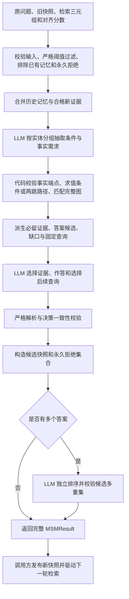

# 成员 D 模块

[English](part_d.md) | [简体中文](part_d.zh-CN.md)

本文说明当前成员 D 实现的模块。默认流程为需求抽取、代码求值、证据选择与作答、发布前校验，以及多答案独立排序。

## 主要交付产物

### `decompose_question`

把原问题分解为一组可独立检索的子问题。默认提示要求每个子问题写全已知实体或未知实体的关系描述，不假定前一问已得到答案；返回顺序与模型输出一致。

输入：

| 变量名 | 类型 | 含义 |
| --- | --- | --- |
| `question` | `str` | 非空原问题，逐字传入，不做改写。 |
| `client` | `LLMClient` | 调用方持有并负责关闭的 LLM 客户端。 |
| `prompt_variant` | `str` | 仅关键字参数，默认 `"explicit_references"`；可选值及含义见下方列表。 |

`prompt_variant` 的可选值：

- `"explicit_references"`（默认）：在论文图 7 模板中插入独立检索增强段，要求每个子问题脱离其他子问题也能独立检索，写全已知实体名或未知实体的关系描述，且不假定前一问已得到答案。
- `"paper"`：只保留论文图 7 的原始指令（编号从 $1$ 开始），不插入增强段，用于复现论文基线与对照。

输出：

| 变量名 | 类型 | 含义 |
| --- | --- | --- |
| `sub_questions` | `list[str]` | 有序子问题列表，字符串原样保留，供调用方分别检索。 |

### `manage_memory`

完成一次独立问题运行中的一轮记忆更新：筛选潜力子图、调用 LLM 更新记忆并作答，多答案时再独立排序。仅整体成功后返回可发布的冻结结果。

输入：

| 变量名 | 类型 | 含义 |
| --- | --- | --- |
| `state` | `QuestionMemory` | 当前问题运行的不可变快照，每个独立问题新建。 |
| `triples` | `Sequence[Sequence[str]]` | 成员 C 提供的扩展三元组，每行三个非空字符串。 |
| `scores` | `Sequence[Real]` | 与 `triples` 位置对齐的有限精炼分数。 |
| `client` | `LLMClient` | 调用方持有并负责关闭的 LLM 客户端。 |
| `potential_threshold` | `Real` | 潜力子图的严格阈值，默认 `0.7`；从 YAML 读取时须显式传入。 |
| `prompt_variant` | `str` | 仅关键字参数，默认 `"evidence_decision"`；可选值及含义见下方列表。 |

`prompt_variant` 的可选值：

- `"evidence_decision"`（默认）：先执行一次结构化需求抽取，由代码校验题型、条件与事实端点，派生必留证据、答案候选和固定查询。最终选择须通过决策一致性校验，否则不发布快照。
- `"paper"`：只使用图 8 原版提示做单次选择，不追加需求抽取或检索措辞增强；多答案仍在选择后独立排序。
- `"retrieval_questions"`：在图 8 提示上追加检索问句增强，要求后续问题面向知识图谱检索器、锚定已命名实体并只询问缺失关系；仍为单次选择。
- `"answer_ranking"`：在图 8 提示上追加检索问句和答案排序增强，让单次选择阶段按证据支持度排列候选；多答案时独立的排序阶段仍会执行。

输出：

| 变量名 | 类型 | 含义 |
| --- | --- | --- |
| `result` | `MSMResult` | 冻结结果，仅在整体成功后发布。 |
| `result.state` | `QuestionMemory` | 本轮更新后的新快照。 |
| `result.response` | `MemoryResponse` | 校验后的结构化输出，含选中三元组、排序答案与下一轮子问题。 |

## 当前默认架构



中间决策不发布记忆。最终输出必须同时满足结构、输入归属、必留证据、答案候选、条件状态和缺口查询约束；排序也成功后，公开入口才返回可发布结果。任一阶段失败均向上传递异常，调用方继续持有原快照；不补选、补答、改写问题或增加业务重试。

条件未知时保护两条分支的已匹配证据并禁止作答；条件确定后只保护适用分支和实际条件事实。必要证据漏选或答案不属于代码派生候选时，在构造候选快照前失败。本地检查证明输出相对于抽取需求与提交图一致，不证明原题理解或需求抽取语义正确。

## LLM 配置与请求

[`llm_config.py`](../src/agent/llm_config.py) 合并私有 `.env` 覆盖与共享 YAML 默认值，并在请求前校验最终配置。模型名与端点可由 `LLM_MODEL_NAME`、`LLM_BASE_URL` 覆盖，密钥只从 `.env` 的 `LLM_API_KEY` 读取；超时和最大额外重试次数只取共享 YAML。共享默认模型为 `gpt-4o-mini`，端点为 `https://api.openai.com/v1`。加载过程不读取进程环境变量，密钥不出现在配置对象的表示中。

[`llm_client.py`](../src/agent/llm_client.py) 提供 `LLMClient.complete(messages, *, response_format=None)`，使用兼容 OpenAI 的 Chat Completions 协议，并关闭进程代理等环境继承。超时、连接失败、HTTP $429$ 和 HTTP $5xx$ 允许最多 `max_retries` 次额外尝试，间隔依次为 $1$、$2$、$4$ 秒，最长 $8$ 秒；其他 HTTP 错误、非 JSON 对象响应和业务校验失败不重试。模型、端点和协议不自动回退。调用方负责关闭客户端。

## 逐次请求用量记录

[`llm_usage.py`](../src/agent/llm_usage.py) 为每次实际 HTTP 尝试追加一行 UTF-8 CSV，包括失败和重试。权威账本为 [`logs/llm_usage.csv`](../logs/llm_usage.csv)，列为 `timestamp, model, input_tokens, output_tokens, status, error_type, request_id`。

时间记录请求开始时刻，使用带偏移的 UTC。模型和 token 数优先采用服务返回值；未知 token 数及请求 ID 留空，已报告的零值保留。HTTP 成功的请求即使随后业务校验失败仍记 `success`，异常只记录类名。日志不含密钥、提示词、三元组、回复正文或异常消息；用量未知不等于零消耗。客户端在发送前检查表头与可写性，追加失败向上传递。并发进程须由调用方串行化 CSV 写入。

## 初始问题分解

[`question_decomposition.py`](../src/agent/question_decomposition.py) 实现 FoG 第 3.1 节和图 7 的初始子问题。`decompose_question(question, client, *, prompt_variant="explicit_references")` 默认要求每个子问题可独立检索：写全已知实体名或未知实体的关系描述，不假定前一问已得到答案，不编造实体名。提示变体的取值见[`decompose_question`](#decompose_question)。返回有序问题列表，供调用方分别检索。

`build_decomposition_prompt` 与 `parse_sub_questions` 可离线使用，不调用 API。问题必须为非空白字符串并逐字插入。完成且未拒答的回复必须是仅含非空白字符串的非空 JSON 数组；代码围栏、说明文字、非法 JSON 和非字符串项均失败，字符串、顺序和重复项原样保留。图 7 未限制子问题数量。非法输入或输出抛出 `ValueError`，消息不包含原文，也不触发额外请求或替代问题。

## 潜力子图构建

[`potential_subgraph.py`](../src/agent/potential_subgraph.py) 实现 FoG 第 3.3 节公式 10：$G^{\mathrm{pot}} = \{t \in G^{\mathrm{xpd}} \mid s_t > \tau_p\}$。`build_potential_subgraph(triples, scores, potential_threshold=0.7)` 接收成员 C 在反馈传播后得到的精炼分数，与扩展三元组逐项对齐。

```python
from src.agent.potential_subgraph import build_potential_subgraph

triples = [
    ("Country A", "anthem", "Song C"),
    ("Country A", "led_by", "Person B"),
]
potential = build_potential_subgraph(triples, [0.95, 0.7])
assert potential == [triples[0]]
```

阈值为有限实数，默认 $0.7$，采用严格大于；等于阈值不入选。分数必须是一维、位置对齐的有限实数序列，布尔值无效；张量须先显式转换为一维 Python 列表。图行必须包含三个非空白字符串。所有行先校验再过滤，低分无效行也会报错；字符串、方向和首次达标顺序保持不变。精确重复行只要任一对应分数达标即可进入后续证据集合。

过滤不调用 LLM，也不建立拒绝状态，判定只使用直接比较，不做 sigmoid、归一化或裁剪；分数刻度由成员 C 决定。本轮未提交且不在历史记忆中的证据不会被永久拒绝，后续重新检索和打分达标时仍可使用。

## 问题级持久记忆

[`memory_state.py`](../src/agent/memory_state.py) 提供 `QuestionMemory(original_question, memory_triplets=(), rejected_triplets=())`。每次独立问题运行创建新实例，即使问题文本相同；同一次运行在各轮之间保存快照。持久仅指运行内保留，不包含磁盘存储或全局问题缓存。

原问题必须是非空白字符串并逐字保存。记忆和永久拒绝均复制为 `frozenset[tuple[str, str, str]]`，精确重复项去重，原字符串及边方向不变；两个集合不得重叠。快照及嵌套值不可变，不受调用后修改输入列表影响。新快照由更新流程构造，调用失败不会更改旧快照。

`state.excluded_triplets` 返回当前记忆与永久拒绝的并集。`state.filter_expansion_triplets(candidates)` 校验全部候选后，按原顺序排除这些完整三元组并精确去重。共享实体或反转方向不会自动排除另一条边。已吸收记忆不重复展开，但每轮仍从 `state.memory_triplets` 独立提交给记忆管理；历史记忆不受本轮检索分数限制。

## 条件证据决策与记忆发布

[`evidence_decision.py`](../src/agent/evidence_decision.py) 实现默认流程的需求抽取与确定性求值。首阶段始终接收原问题，以及历史记忆和合格新证据的完整并集；不先让模型裁剪图。

### 需求抽取与端点绑定

首阶段使用严格结构化输出，`description.kind` 为 `conditional_equals`、`nonconditional`、`nonconditional_path` 或 `unsupported`。题型由原问题决定：只有原题显式规定相等条件的真假分支时才使用 `conditional_equals`；多个已命名对象分别查属性，或同一对象查多个独立关系，使用 `nonconditional`；先定位实体再询问其属性属于依赖，即使图中已知中间实体也使用 `nonconditional_path`。相等条件描述主体、关系、运算符 `eq`、比较值、原问题中的条件引文及可选单值前提引文。比较值只作为条件约束，不作为已观察事实；不能从图中制造条件，也不能仅凭定冠词推断单值。

单跳需求的每个分支按 `requirements: [{entity, fact_queries: [{relation, binding}]}]` 组织。`entity` 是原题询问其属性的已知对象，不是检索到的答案端点；每个查询从所属组继承对象，不重复生成对象字段。同一分支内重复的实体组会被拒绝，相关多关系应放入同一组。条件题提供 `true` 和 `false` 两个非空分支，非条件单跳题提供单一 `branch`。

`observed` 绑定引用本轮排序图的稳定三元组编号，每个编号的精确关系必须把组实体作为一端。代码校验编号、关系和端点角色，从端点位置派生出向或入向；多个引用须支持相同方向，自环或角色歧义终止事务。确定方向后仍扫描完整图，收集同一对象、关系和方向的全部匹配事实，避免只保留模型引用的一条。

`missing` 绑定声明待检索方向，不携带预测答案。代码检查两个方向的精确事实：任一方向已有该精确关系时以 `decision_conflict` 拒绝，其中仅另一方向命中的判定是保守策略，可能拒绝合法的另一方向查询；两侧均无命中才允许缺口。该策略不代表通用关系方向推理。编号只在当前请求内有效，不能跨轮复用。

### 非条件两跳路径求值

`nonconditional_path` 使用逐字来自原题的 `root_entity` 和恰好两项的有序 `steps`，每步为 `relation + binding`，并使用独立绑定 schema。关系已在图中出现时必须精确匹配；缺失关系由模型描述，不填写中间实体或预测答案。

`observed` 绑定只引用当前编号图的 `evidence_ids`。代码依据当前可达前沿的端点角色推导该步方向，再遍历同方向的全部精确匹配事实，将另一端作为下一步前沿。编号越界、关系或连接不符、自环、端点角色歧义，以及声明方向无事实但反向命中，均终止事务。同一步部分候选已有事实、部分缺失时，缺失候选继续使用观测事实推导的方向。

完全缺边时绑定只能为 `{"kind": "missing"}`，不携带方向或证据编号；只有当前前沿所有实体的两侧均无该精确关系，才生成 `scope="incident"` 的关系邻接缺口。已有事实却报缺失时失败。前沿为空后仅保留下游需求，不编造中间实体，也不生成尚不可达对象的查询；后续事实到达后重新使用观测绑定推导方向。

代码保护全部可达路径前缀，任一候选仍有缺口时禁止作答；无缺口时答案必须来自终跳 `answer_candidates`，不能回答中间实体或不相连的端点。路径求值复用完整图、必留证据、拒绝及排序发布规则，不持久化跨轮证据编号或另建路径状态。

### 条件求值与必留集合

代码在完整提交图中按精确主体和关系（主体为头端）查找实际条件值。匹配比较值时为 `true`；存在不同值且原题明确单值时为 `false`；否则为 `unknown`。单值前提下出现多个实际值会失败；非条件题状态为 `not_conditional`。缺少事实不自动视为条件不成立。

必留集合由实际条件事实与适用分支的全部匹配事实构成。条件未知时合并两分支，保护已有候选路径；条件确定后只使用对应分支。答案候选取适用分支匹配事实的另一端实体（出向取尾端、入向取头端），按原字符串去重并按字典序排序；条件未知时候选为空，条件事实只有同时匹配回答需求才进入候选。代码同时派生回答对象与缺失关系交给最终选择阶段，不依赖模型重新列举必留证据。

### 缺口查询与发布门槛

[`memory_prompt.py`](../src/agent/memory_prompt.py) 的 `build_decision_memory_prompt` 向最终阶段提交原问题、完整证据、派生决策和必留约束。有缺口时，`missing_relation_queries` 为每个缺口渲染查询文本，按原字符串精确去重并保持首次出现顺序：

```text
Which entity does "<target>" connect to through relation "<relation>"?
Which entity connects to "<target>" through relation "<relation>"?
Find triples involving "<target>" with relation "<relation>".
```

前两种模板用于已有方向的缺口；第三种仅用于两跳路径完全缺边时的 `scope="incident"` 缺口，允许召回目标实体作为头端或尾端的关系事实。不先猜方向、不自动翻转旧查询，也不同时发送两条正反查询；本轮允许查询列表随后追加到最终请求中。该契约不保证缺失关系命名正确，实际召回和开销由成员 E 集成验证。

最终请求统一使用基础 `MEMORY_RESPONSE_FORMAT` 严格 schema，不生成动态查询枚举。模型通过 `subsequent_question` 原样选择查询；本地校验要求非空、无重复、全部属于本轮允许集合，并包含所有未知条件查询。至多三问，多缺口可以分轮检索；未询问的缺口不会因此变成已满足。

最终输出先经过 `parse_memory_response`，再由 `validate_decision_response` 检查：全部必留证据已选中；条件未知时无答案；条件已确定或非条件题且无缺口时必须作答、不再追问；单跳／条件答案与两跳答案分别属于对应 `answer_candidates`。任何不一致均在返回可继承快照前失败。固定查询保证与派生缺口一致，不能证明模型抽取完整或真实检索必然召回。

### 显式对照接口

`manage_memory` 和 `update_memory` 均默认选择上述两阶段决策流程。`prompt_variant` 的完整取值见[`manage_memory`](#manage_memory)；默认流程失败时不自动切换其他变体。所有公开 `manage_memory` 变体都保留多答案独立排序。

`build_memory_prompt` 只构造单次选择提示，仍默认 `retrieval_questions`，不代表完整事务入口。它保留论文的高召回、仅依据证据作答和精确复制要求；调用方应使用 `manage_memory` 获得默认发布保护。

## 结构化记忆输出

[`memory_response.py`](../src/agent/memory_response.py) 提供 `parse_memory_response(content, memory_triplets, potential_triplets)`。它是最终输出的基础解析边界，不负责首阶段抽取或完整事务发布。回复必须是完整的标准 JSON 对象，恰有以下三个数组字段：

```json
{
  "selected_triplets": [],
  "predict_answer": [],
  "subsequent_question": []
}
```

全空对象只是格式示例：没有答案时仍须返回 $1$ 至 $3$ 个非空白问题。`selected_triplets` 每行须包含三个非空白字符串，逐字匹配本次实际提交并集中的完整三元组；行内字段位置、方向、大小写、空白及 Unicode 不归一化。`predict_answer` 必须逐字匹配选中三元组的头或尾实体；仅出现在未选中证据、仅作为关系出现或经过改写的答案均被拒绝。空选择只能返回空答案。

返回不可变 `MemoryResponse`，三个字段均为元组，三元组行也为元组。基础解析保留原字符串、行顺序和重复项；默认流程另对追问执行上文的集合与去重校验。缺少、多余或重复字段、代码围栏、额外文字、尾随值、非标准 JSON 数值和越界值全部失败，不修复输出。

解析器能检查任意已选路径的实体归属，而本地成员归属检查不证明答案语义、完整性或支持强弱，排序也不补齐遗漏答案。直接构造 `MemoryResponse` 容器不会执行这些校验。

## LLM 引导的记忆替换

[`memory_update.py`](../src/agent/memory_update.py) 提供 `update_memory(state, potential_triplets, client, *, prompt_variant="evidence_decision")`，负责排序前的决策、最终选择、解析和候选快照构造。新记忆严格等于最终选中三元组的集合；旧证据只有再次选中才保留，不自动与旧记忆取并集。默认必留约束先保护当前需求所需证据，再允许移除已不适用的旧证据。

潜在输入支持空图和生成器，先物化一次，确保所有阶段使用同一份证据。无效状态、图格式错误，或潜在输入与永久拒绝集合重叠时，请求前失败。仅正常完成、未拒答且通过全部输出及决策检查的事务才构造候选快照；本次提交但未选中的三元组随后加入永久拒绝。传输和记账错误向上传递。该底层接口不执行独立排序，完整 MSM 应使用公开入口。

## 探索效率

设实际提交并集为 $U = G^{\mathrm{mem}} \cup G^{\mathrm{pot}}$，最终选中集合为 $S$，已有永久拒绝为 $R$。通过全部校验后，新记忆为 $S$，永久拒绝更新为 $R' = R \cup (U \setminus S)$。已提交但未选中的新证据和旧记忆均进入永久拒绝，规则在问题运行内持续有效，记忆清空也不重置。

将省略的已提交输入解释为“显式拒绝”是用户批准的复现假设，论文没有明确给出这一映射。已发布的拒绝不会自动解除；默认流程通过发布前的必留与候选校验保护必要证据。格式、决策、一致性、传输或排序失败均不向调用方发布新增拒绝。

调用方在检索和每步展开边界、打分前调用 `state.filter_expansion_triplets`。公开 `manage_memory` 还会在合格潜在输入上应用过滤，保证永久拒绝证据不会再次提交给 LLM。已吸收记忆从旧快照独立补回证据并集。本模块不实现检索器，也不修改成员 C 的打分逻辑。

## 阈值隐藏证据的容错

分数 $s_t \leq \tau_p$、且未在历史记忆中的证据不属于本轮提交并集，不产生永久拒绝。调用方把实际 `response.subsequent_question` 交给检索器，重新展开、过滤并打分后，原隐藏证据只要分数严格超过阈值，仍可重新进入潜在图。恢复依赖再次检索与打分，不自动降低阈值或重新插入事实。

空潜在图合法：仍提交历史记忆；两者都为空时提交空图，缺失关系驱动后续查询。永久拒绝的证据即使高分重输也保持过滤。所有状态按独立问题运行隔离，不因问题文本相同而共享。

## 独立答案排序

[`answer_ranking.py`](../src/agent/answer_ranking.py) 在最终作答产生不少于两个答案时单独调用 LLM。输入仅含原问题、实际选中三元组和实际候选答案，不传检索分数、金标准或未选中证据。零或单答案自动跳过，无关闭排序的业务开关。

排序回复必须正常完成、未拒绝，仅返回 `predict_answer`。候选原字符串和多重集须完全不变，禁止增删、改名或去重；只允许改变顺序，不改变证据、问题、记忆或永久拒绝，也不能补救上游漏答案或漏路径。排序失败时，完整 `manage_memory` 不返回候选快照。`manage_memory_ranked` 是 `manage_memory` 的兼容别名，两者行为相同。

## MSM 重打分轮次接口

[`memory_management.py`](../src/agent/memory_management.py) 提供 `manage_memory(state, triples, scores, client, potential_threshold=0.7, *, prompt_variant="evidence_decision")`。成员 C 提供对齐三元组与精炼分数；成员 E 持有问题快照、检索循环、客户端及停止策略。函数本身不读取配置、不检索、不原地修改状态。阈值过滤后再应用状态排除，避免已吸收或已拒绝证据重复进入提示。

```python
from src.agent.llm_client import LLMClient
from src.agent.llm_config import load_llm_config
from src.agent.memory_management import manage_memory
from src.agent.memory_state import QuestionMemory

state = QuestionMemory("Which city was Mira Vale born in?")
client = LLMClient(load_llm_config())
try:
    result = manage_memory(
        state,
        [("Mira Vale", "born_in", "Linden City")],
        [0.95],
        client,
        potential_threshold=0.7,
    )
    state = result.state  # Publish only after every stage succeeds.
    next_queries = result.response.subsequent_question
finally:
    client.close()
```

这段示例会产生真实 API 用量。返回冻结的 `MSMResult(state, response)`；仅整体成功后发布 `result.state`，再用 `response.subsequent_question` 驱动下一轮检索。默认每轮正常 $2$ 次逻辑请求，多答案为 $3$ 次，各自遵循客户端传输重试及逐次记账；空输入也仍会调用 LLM。

## LLM 异常与状态保持

默认事务的首阶段、最终阶段和可选排序均属同一公开调用。HTTP、记账、回复封装、严格 JSON、证据或答案归属、决策一致性及排序校验中任一失败，均不返回部分 `MSMResult`。调用方继续持有原快照及既有拒绝集合；输出校验不触发业务重试或备用提供方。如何停止整题、记录失败或稍后显式重试由成员 E 决定。

[`validation_error.py`](../src/agent/validation_error.py) 通过 `ValueError` 子类和固定 `failure_stage`、`error_code` 定位记忆输出失败，覆盖 `evidence_decision`、`decision_consistency` 及基础解析阶段。未识别异常记为 `unclassified`，不复制任意异常消息。HTTP 成功与业务验收成功分别记录。

## 后续子问题

`response.subsequent_question` 是下一轮检索使用的有序字符串元组，不是面向用户的问答。调用方直接传递这些查询，不重新执行初始分解；后续事务仍使用 `state.original_question`。

默认查询由已派生的缺口生成并在发布前校验，规则见[缺口查询与发布门槛](#缺口查询与发布门槛)。无答案时须有 $1$ 至 $3$ 问；有真实缺口时可以分轮补充证据；条件已定且无缺口时必须作答并停止追问。基础解析器保留字符串，不生成替代问题；完整默认事务额外限制允许集合、重复项和未知条件必问项。

## 真实验收入口

[`scripts/validate_part_d.py`](../scripts/validate_part_d.py) 通过公开接口加载真实配置并调用 LLM，仅以受控数据替代 C/E 检索打分，严格阈值为 $0.7$。不修复输出、不增加业务重试，最终关闭客户端。

```text
python scripts/validate_part_d.py --list-cases
python scripts/validate_part_d.py --suite multihop --list-cases
python scripts/validate_part_d.py --suite multihop
python scripts/validate_part_d.py --suite conditional --list-cases
python scripts/validate_part_d.py --suite single
python scripts/validate_part_d.py --suite multi
python scripts/validate_part_d.py --suite removal
python scripts/validate_part_d.py --suite ranking
python scripts/validate_part_d.py --suite conditional
python scripts/validate_part_d.py --suite all
```

`--list-cases` 免费且不读取私有配置；其余命令产生真实用量。默认每个记忆事务最多 $3$ 次逻辑调用（抽取、选择、排序），初始分解为 $1$ 次。下表按共享 YAML 当前额外重试 $2$ 次计算 HTTP 上限：

| 验收组 | 用例／事务数 | 逻辑调用上限 | HTTP 尝试上限 |
| --- | --- | --- | --- |
| `single`，含一次分解 | $4$ | $10$ | $30$ |
| `multi` | $4$ | $12$ | $36$ |
| `removal` | $3$ | $9$ | $27$ |
| `ranking` | $2$ | $6$ | $18$ |
| `all`，上述四组 | $13$ | $37$ | $111$ |
| `conditional`，单独运行 | $8$ | $24$ | $72$ |
| `multihop`，单独运行 | $6$ | $18$ | $54$ |

`multihop` 仅使用默认 `evidence_decision`，复用 `single.sufficient`、`single.insufficient`、`single.empty`、`multi.partial`、`multi.recovery` 和 `multi.exclusion_probe`，不运行分解或独立隔离用例。`conditional` 不加入 `all`，覆盖 Silver／Bronze 的条件完整图与 `unknown`、`resolved`、`probe` 三轮链。`reference_diagnostic`、`clarification_diagnostic` 和 `empty_diagnostic` 为独立诊断组，均不加入 `all`。

显式 `--prompt-variant paper`、`retrieval_questions` 或 `answer_ranking` 可运行对照，`all` 上限相应变为最多 $25$ 次逻辑调用、$75$ 次 HTTP 尝试，不自动回退。

每次运行保存唯一的私有 `tmp/tmp_part_d_validation_<UTC timestamp>.json`，包含受控输入、实际查询、有效输出、成功事务的分阶段请求与 schema、原始完成回复及前后快照。失败只保存异常类及固定诊断，不保存失败原文、密钥或任意异常消息。实际 HTTP 用量继续写入共享账本；报告不提交仓库。退出码 $0$ 表示结构、状态及该组自动检查通过，`semantic_review` 仍待人工审阅。
